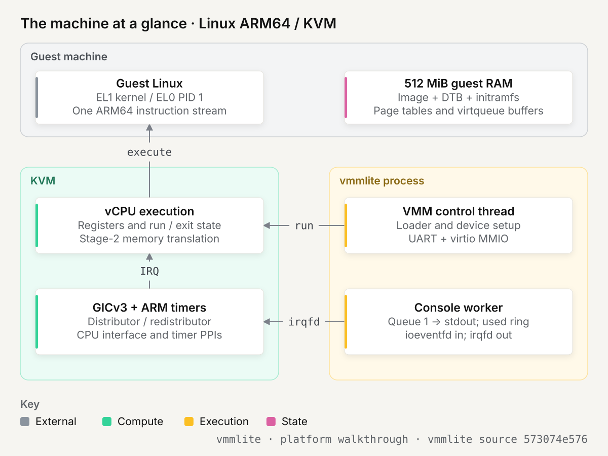
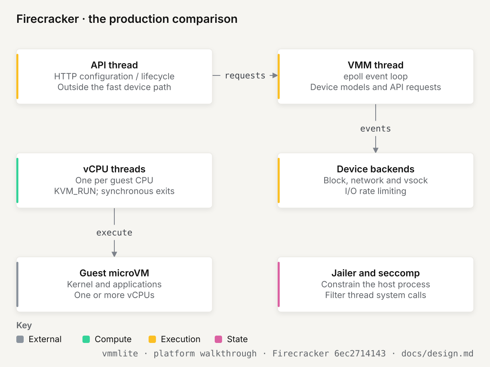
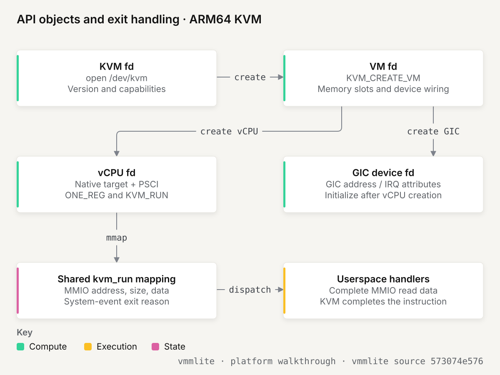
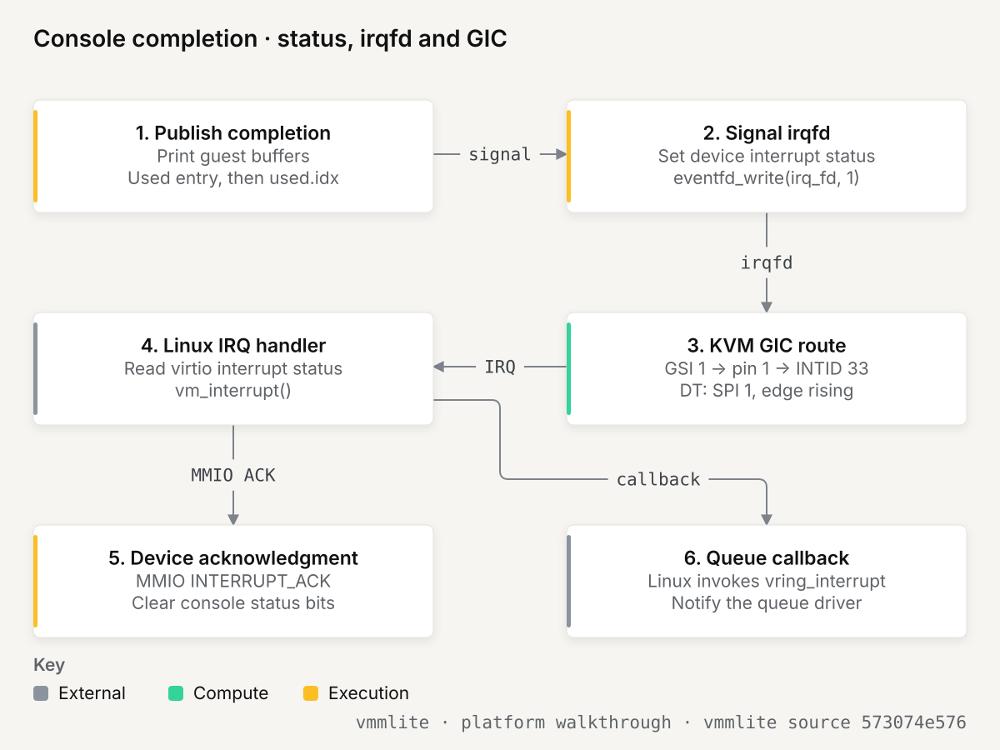

# vmmlite: booting Linux on Linux ARM64

## TL;DR

One C file builds an ARM64 KVM machine, boots Linux, prints from PID 1 through a virtio console, and exits on PSCI reset. The walkthrough follows the x86 example, with the ARM boot contract made explicit.

## The machine at a glance

The host is an AArch64 Linux system. The guest is another AArch64 Linux system. The VMM is a normal host process; it supplies memory and device behavior, while KVM and the CPU execute the guest.

<picture>
  <source media="(prefers-color-scheme: dark)" srcset="diagrams/machine.dark.svg">
  
</picture>

| Part | What it is for, in plain words |
| --- | --- |
| Core | A real processor executes guest instructions. KVM enters the guest and handles operations that require the hypervisor (0.2). |
| EL1 / EL0 | The guest kernel's privilege level and the level used by its programs, including PID 1 (0.1). |
| Stage-2 translation | Maps guest physical addresses to the host pages assigned to this VM (0.3). |
| RAM | 512 MiB of the VMM's memory, mapped into the guest at `0x40000000` (0.3). |
| MMIO | Device registers reached with loads and stores. ARM has no x86 `IN` / `OUT` port space (0.6). |
| GIC distributor | Routes shared peripheral interrupts, including the UART and console (0.8). |
| GIC redistributor | Holds private interrupt state for this CPU and identifies its affinity (0.8). |
| GIC CPU interface | Lets Linux acknowledge an interrupt and complete its handling (0.8). |
| Architected timer | A counter/deadline mechanism for timekeeping and wakeups; KVM supplies its virtualization (0.8). |
| 8250 UART | Prints the early boot log one byte at a time. The small register model lives in `com1()`. |
| Virtio console | Linux's `hvc0`: Linux leaves text in RAM and notifies the device that buffers are ready (0.9). |
| Device tree | The machine description passed in `x0`: RAM, CPUs, GIC, timers, devices and boot arguments (0.7). |
| PSCI | The firmware-call convention used to reset or power off. KVM implements it; a system-event exit ends this run. |
| `console_thread()` | The host worker that prints queued buffers and returns them to Linux. |
| `ioeventfd` | Connects a matching guest doorbell write to a host eventfd without returning that access to the VMM's run loop. |
| `irqfd` | Connects a host eventfd signal to a guest interrupt route. |

### Firecracker's machine, for comparison

<picture>
  <source media="(prefers-color-scheme: dark)" srcset="diagrams/firecracker.dark.svg">
  
</picture>

Firecracker also supports ARM64 on Linux/KVM. Its process separates API work, vCPU execution and device events. An API request configures a machine; vCPU threads enter KVM; a VMM event loop handles backend work. Its block, network and vsock devices connect guest requests to host files, TAP interfaces and communication endpoints.

| Additional part | Why a production VMM needs it |
| --- | --- |
| Multiple vCPU threads | Run more than one guest instruction stream. |
| API thread | Receive configuration and lifecycle requests over an HTTP API. |
| VMM event loop | Wait for and dispatch work from many devices. |
| Block and network devices | Give applications storage and network connectivity. |
| Vsock | Connect host and guest applications without configuring an IP network. |
| Lifecycle machinery | Coordinate start, pause, resume and snapshots. |
| Jailer and seccomp | Limit the host process's access and allowed system calls. |

This comparison comes from [Firecracker's architecture](https://github.com/firecracker-microvm/firecracker/blob/6ec271414300fb8f0ff1ff79ad321bb7467d072f/docs/design.md). It is a comparison of responsibilities, not a claim that vmmlite has these production guarantees. The example has no host sandbox, storage, network or input device.

## 0. Background: the CPU, KVM and devices

Nine topics explain the machinery before the boot sequence. References to steps 1–9 correspond to the numbered comments in `main()`.

### 0.1 ARM64 system architecture: what the kernel controls

An instruction set includes more than arithmetic and load/store instructions. The system architecture describes execution privilege, memory translation, exceptions, interrupt state and timers. An operating system controls these through registers and privileged instructions.

```text
                          /init and other programs: EL0
                         SVC |                    ^ ERET
                             v                    |
                         Linux kernel: EL1
        +--------------------+--------------------+--------------------+
        | execution state    | memory translation | exceptions / time  |
        +--------------------+--------------------+--------------------+
 state  | PC, general regs   | TTBR0/1_EL1        | VBAR_EL1           |
        | PSTATE, DAIF       | TCR_EL1, MAIR_EL1  | ESR_EL1, FAR_EL1   |
        | SCTLR_EL1          | page tables       | CNTVCT, CNTV_CVAL  |
        +--------------------+--------------------+--------------------+
 change | MRS / MSR          | MSR, TLBI, DSB     | MSR, ERET, WFI     |
        | exception return   | ISB                | GIC CPU-interface |
        +--------------------+--------------------+--------------------+
 effect | execute at selected| translate accesses | enter exception    |
        | level and masks    | or raise a fault   | handler / wake CPU |
        +--------------------+--------------------+--------------------+
```

`EL0` is the privilege level used by ordinary guest programs. `EL1` is used by this guest kernel. Hypervisor facilities at `EL2` separate the guest's machine state from the host. This example does not expose a guest hypervisor. Starting the Linux kernel at guest EL1 does not give it host-kernel privileges.

| Register or state | Meaning | What the example does |
| --- | --- | --- |
| `PC` | Address of the next guest instruction | Sets it to the Image's load address. |
| `x0` | First general argument register | Points to the device tree. |
| `x1`–`x3` | Reserved boot arguments | Sets them to zero. |
| `PSTATE` | Execution level, stack selection and exception masks | Starts EL1h with D/A/I/F masked (`0x3c5`). |
| `SCTLR_EL1` | Controls EL1 MMU and caches | Uses the MMU-off reset state provided by vCPU initialization. |
| `TTBR0_EL1`, `TTBR1_EL1` | Roots of guest page tables | Linux sets them during its own initialization. |
| `VBAR_EL1` | Base of the guest exception vector table | Linux installs its exception handlers. |
| `MPIDR_EL1` | CPU affinity identity | Reads it through KVM and puts its affinity bits in the DT CPU node. |
| `CNTVCT_EL0` | Virtual count value | Linux uses the architected timer infrastructure for timekeeping. |

The `h` in EL1h means that execution uses the EL1 stack pointer rather than the EL0 stack pointer. It does not mean that the VMM has initialized a useful C stack for Linux. The kernel's assembly entry code establishes the state it needs before reaching ordinary C code.

ARM exception vectors and device interrupt IDs are different things. An IRQ takes the CPU to an IRQ entry in the vector table. The handler then reads the GIC CPU interface to learn which interrupt is active. INTID 33 does not mean vector-table entry 33.

**In vmmlite:** step 6 writes PC, PSTATE and x0–x3 with `KVM_SET_ONE_REG`. The [ARM64 boot protocol](https://docs.kernel.org/arch/arm64/booting.html) defines those initial conditions; Linux then builds its own runtime state.

### 0.2 Guest execution: VM entry and VM exit

`KVM_RUN` is a host ioctl issued by the thread responsible for a virtual CPU. While that call runs, the physical CPU can execute guest instructions. Hardware virtualization retains separate guest and host contexts.

```text
VMM's vCPU thread               Linux / KVM                     CPU
KVM_RUN ---------------------> restore guest state ----------> execute Linux
                                 ^                             instructions
                                 | hardware exit <----------- device/system event
                                 |
                                 +-- handle internally ------> resume guest
                                 |
return to userspace <-----------+-- userspace work required
handle exit; KVM_RUN ---------> complete prior MMIO ----------> resume guest
```

A hardware exit is not necessarily a return to the VMM process. KVM can handle an operation and resume the guest inside the same ioctl. The VMM sees only exits that the API returns to userspace.

This distinction explains why an empty run loop is not enough to describe a VMM's machine. GIC operations, timer virtualization, idle waits and PSCI calls can involve KVM without appearing as individual switch cases in the C program. The userspace loop handles UART and virtio control accesses, plus the final shutdown/reset event.

A guest executing `WFI` is waiting for an interrupt. That does not mean the VM has finished. KVM can arrange for a halted vCPU to wait and resume when an event becomes deliverable. The worker's `irqfd` signal and architected timer are examples of sources that can make progress possible.

The VMM's main thread and the guest do not execute simultaneously on that same thread. The main thread is inside `KVM_RUN` while the guest runs. The separate console worker can execute concurrently, which is why guest-memory ordering and device-state locking matter.

**In vmmlite:** step 8 repeats `KVM_RUN`, retries `EINTR`, dispatches `KVM_EXIT_MMIO`, and accepts reset/off `KVM_EXIT_SYSTEM_EVENT`. Other exit reasons fail with a diagnostic. See the [KVM API](https://docs.kernel.org/virt/kvm/api.html).

### 0.3 Guest memory: two translations and one host mapping

After Linux enables its MMU, a normal guest access follows two translations:

```text
guest instruction addresses virtual byte V
        |
        | stage 1: guest page tables, controlled by Linux
        v
guest physical address G
        |
        | stage 2: KVM's mappings for this VM
        v
host physical page backing the guest's memory

userspace device model accesses the same byte through:
        ram + (G - 0x40000000)
```

The device model's pointer arithmetic is not a third hardware translation stage. It is how host C code locates the bytes in its own virtual address space. KVM's memory-slot registration ties guest physical ranges to that host allocation.

`mmap()` obtains a 512 MiB host virtual allocation. `KVM_SET_USER_MEMORY_REGION` registers it as guest RAM from `0x40000000` through `0x5fffffff`. The memory slot does not create the guest's page tables. Linux does that itself after entering with the MMU off.

At initial entry, guest addresses used by the kernel are physical because guest stage 1 is disabled. Stage 2 still enforces the VM's physical-memory mapping. Turning off the guest MMU does not turn off host isolation.

| Address | Meaning in this machine | Who handles it |
| --- | --- | --- |
| `0x40000000`–`0x5fffffff` | Guest RAM | KVM maps the host allocation. |
| `0x08000000` | GIC distributor | KVM's virtual interrupt controller. |
| `0x10000000` | GIC redistributor | KVM's virtual interrupt controller. |
| `0x09000000` | UART register window | Userspace `com1()` through MMIO exits. |
| `0x0a000000` | Virtio register window | Userspace control path; queue-1 kicks can use ioeventfd. |

An address outside RAM is not automatically a valid device. The example recognizes only its documented device windows and access widths. Unknown accesses fail instead of silently mapping arbitrary memory.

The bounds check is deliberately written as subtraction. Checking `address + size <= end` could allow an overflowing addition to wrap. Here, `guest()` first checks the lower bound and size, then compares `address - RAM_BASE` with `RAM_SIZE - size`. Every file destination and descriptor buffer must stay inside the declared RAM region.

The shared pages can be accessed concurrently by the guest and worker. A host mutex serializes host device configuration, but cannot lock the guest CPU. Virtqueue publication uses separate acquire/release operations, described in 0.9.

**In vmmlite:** step 2 establishes the slot; `guest()` translates checked physical ranges for the loader and console. [KVM memory-slot API](https://docs.kernel.org/virt/kvm/api.html#kvm-set-user-memory-region)

### 0.4 What exits, and who handles it

The useful boundary is the boundary of this C process, not every hardware trap.

| Guest activity | Owner of the behavior | Userspace result |
| --- | --- | --- |
| Ordinary instructions and RAM accesses | CPU and KVM | No device dispatch. |
| Stage-2 memory management | KVM | Not a userspace page-table implementation. |
| GIC distributor, redistributor and CPU interface | KVM VGICv3 | Not handled by `mmio()`. |
| Architected timer and idle wait | KVM and timer virtualization | No userspace periodic tick thread. |
| UART load/store | `com1()` | `KVM_EXIT_MMIO`, one byte per access. |
| Virtio configuration/status access | `console_register_*()` | `KVM_EXIT_MMIO`, aligned four-byte access. |
| QueueNotify=1 at `0x0a000050` | KVM ioeventfd, then console worker | Matching write signals an eventfd. |
| QueueNotify=0 | The transmit-only model | Ignored through the control path. |
| PSCI reset or power-off | KVM PSCI implementation | `KVM_EXIT_SYSTEM_EVENT`. |
| Unsupported userspace exit | This example has no implementation | Diagnostic and nonzero termination. |

The two console paths are intentionally different. A UART is represented by individual register accesses. A virtio doorbell is a notification about shared-memory work; the eventfd lets the worker find that work without routing the doorbell through the main run loop.

This is also where the ARM macOS example differs. Both guests are ARM64 and can use a similar memory map and device tree. But Hypervisor.framework exposes an exception report that the macOS code decodes, while KVM presents a structured MMIO operation. PSCI implementation ownership is different too: Linux KVM implements it for this vCPU; the macOS example handles the relevant HVC calls in userspace.

**In vmmlite:** `mmio()` dispatches the operations KVM returns. It does not advance PC. KVM completes the pending MMIO instruction when userspace calls `KVM_RUN` again.

### 0.5 KVM's API: three handles, a GIC device and the run mapping

<picture>
  <source media="(prefers-color-scheme: dark)" srcset="diagrams/api.dark.svg">
  
</picture>

| Object | Obtained with | What it controls |
| --- | --- | --- |
| KVM fd | `open("/dev/kvm")` | API version, capabilities, VM creation, run-map size. |
| VM fd | `KVM_CREATE_VM` | RAM slots, vCPUs, devices, interrupt routing and eventfd bindings. |
| vCPU fd | `KVM_CREATE_VCPU` | Native target initialization, register access, timer attributes, execution. |
| GIC device fd | `KVM_CREATE_DEVICE` with VGICv3 type | GIC addresses, number of IRQs and initialization. |
| `struct kvm_run *` | `mmap()` of the vCPU fd | Exit reason and MMIO/system-event fields shared with KVM. |
| Three eventfds | `eventfd()` | Console kicks, completion interrupt signals and worker shutdown. |

The run mapping is not guest RAM and is not the entire register file. It is a communication area between the VMM and KVM. Register initialization uses `KVM_SET_ONE_REG`; memory registration uses a VM ioctl; execution uses the vCPU ioctl.

```text
/dev/kvm fd
  +-- KVM_CREATE_VM --> VM fd
  |                     +-- memory slot --> host mmap backing guest RAM
  |                     +-- CREATE_VCPU --> vCPU fd --> mmap(kvm_run)
  |                     +-- CREATE_DEVICE --> GIC fd --> device attributes
  |                     +-- IOEVENTFD / IRQFD --> eventfd bindings
  +-- GET_VCPU_MMAP_SIZE --> length used for the vCPU mapping
```

A vCPU has an ARM target and feature bitmap. The example obtains the preferred native target, enables the PSCI feature and calls `KVM_ARM_VCPU_INIT`. It does not fabricate x86 CPUID leaves or ask ARM to emulate a particular x86 processor.

GIC creation is a device-control operation. For this single CPU, the distributor is a 64 KiB window and the redistributor region is 128 KiB. The example requests 64 interrupt IDs in total: the first 32 are private IDs, leaving 32 shared peripheral IDs. It creates the vCPU before the final GIC initialization ioctl, as required by the [VGICv3 device contract](https://docs.kernel.org/virt/kvm/devices/arm-vgic-v3.html).

On normal shutdown the worker receives `stop_fd`, is joined, and only then are the guest mappings and file descriptors released. An unexpected failure terminates this one-shot process. There is no reusable multi-VM service or partial-recovery state machine hidden behind these helpers.

**In vmmlite:** steps 1, 4, 5 and 7 assemble these objects. `checked_ioctl()` reports the failed operation; `require()` reports violated example contracts.

### 0.6 Device registers: MMIO, UART and virtio control

MMIO gives an address a device meaning. Loading a UART status register asks whether the transmitter is ready. Storing its transmit register sends a byte. The guest's load/store instruction looks like a memory access, but the device determines its effect.

ARM64 uses this mechanism for both devices in the example. The x86 example additionally uses the separate I/O-port address space and `IN` / `OUT` instructions. Consequently there is no `KVM_EXIT_IO` branch here.

```text
Linux early console                          vmmlite
read  byte [0x09000005] -- MMIO exit -------> LSR = THRE | TEMT
write byte [0x09000000] -- MMIO exit -------> putchar(byte)

Linux virtio driver                          vmmlite
read  word [0x0a000000] -- MMIO exit -------> magic 0x74726976
write word [0x0a000030] -- MMIO exit -------> select a queue
write word [0x0a000050] -- matched ioeventfd -> wake worker for queue 1
```

The MMIO record contains a guest physical address, a length, a direction and up to eight data bytes. The example accepts byte accesses for the UART and aligned 32-bit accesses for virtio. A read places its result in the record before reentering KVM. It neither decodes an ARM instruction nor edits the instruction pointer.

The UART is a small 8250 subset:

| Offset | Register | Behavior |
| --- | --- | --- |
| 0 | Transmit / receive | Output prints a byte; receive reads zero. |
| 1 | Interrupt enable | Retains IER and handles transmit-empty enable. |
| 2 | Interrupt identification | Reports and acknowledges a pending transmit-empty event. |
| 3 | Line control | Retains LCR, including divisor-latch selection. |
| 5 | Line status | Reports transmitter empty and holding register empty. |

When LCR's DLAB bit is set, offsets 0 and 1 are divisor registers, not ordinary TX and interrupt-enable registers. Ignoring that distinction would print baud-divisor bytes into the boot log or change interrupt state during serial setup. FIFO control and unused registers do not implement a full UART.

Virtio uses a larger register block. Its important registers are:

| Offset | Register | Role |
| --- | --- | --- |
| `0x000`, `0x004`, `0x008` | Magic, version, device ID | Identify modern virtio-MMIO version 2 and console device 3. |
| `0x010`, `0x014` | Device features and selector | Offer feature bit 32, `VIRTIO_F_VERSION_1`. |
| `0x020`, `0x024` | Driver features and selector | Record the driver's accepted feature pages. |
| `0x030`, `0x034`, `0x038` | Queue selector, maximum, size | Select the queue and size it, up to 256 entries. |
| `0x044` | Queue ready | Validate the transmit queue geometry and enable it. |
| `0x050` | Queue notify | Signal that a queue has newly available buffers. |
| `0x060`, `0x064` | Interrupt status / acknowledge | Report and clear the used-buffer interrupt bit. |
| `0x070` | Device status | Negotiate features, mark DRIVER_OK, or reset. |
| `0x080`, `0x090`, `0x0a0` | Queue addresses, low words | Descriptor, available and used areas; the following word carries high bits. |

Configuration and bulk data have separate paths. These registers tell the device where queues are. The text itself is in RAM, not encoded in the doorbell value.

**In vmmlite:** `com1()`, `console_register_read()` and `console_register_write()` model these registers. [Virtio MMIO specification](https://docs.oasis-open.org/virtio/virtio/v1.2/virtio-v1.2.html)

### 0.7 How Linux learns its hardware: the device tree

ARM64 does not universally require a device tree; Linux also supports ACPI-based ARM systems. This deliberately small machine chooses a DTB because it directly describes the handful of devices the example implements. No UEFI or BIOS executes before the kernel.

`machine.dts` is a text description. `dtc` compiles it into a flattened device tree, and `libfdt` fills in values known only when the files and vCPU have been created.

```text
machine.dts -- dtc --> machine.dtb -- load into guest RAM --> 0x48000000
                                    |
                                    +-- fill initramfs start / end
                                    +-- fill CPU affinity from MPIDR
                                    +-- fill physical / virtual timer PPIs
                                    +-- pack the final tree

x0 = 0x48000000 --> Linux reads /chosen, memory, CPUs and platform devices
```

| Node / property | What it tells Linux |
| --- | --- |
| `/memory@40000000/reg` | RAM begins at 1 GiB and is 512 MiB long. |
| `/cpus/cpu@0/reg` | CPU affinity, matching the initialized virtual CPU. |
| `/interrupt-controller@8000000` | GICv3 distributor and redistributor ranges. |
| `/timer/interrupts` | Timer PPI numbers in the binding's defined order. |
| `/serial@9000000` | 8250 MMIO base, reference clock and level-high SPI 0. |
| `/virtio_mmio@a000000` | Virtio-MMIO register window and edge-rising SPI 1. |
| `/psci` | PSCI 0.2-compatible interface, using the HVC conduit. |
| `/chosen/bootargs` | `earlycon=uart8250,mmio,0x09000000 console=hvc0 panic=-1`. |
| `/chosen/linux,initrd-start` | First byte of the cpio archive. |
| `/chosen/linux,initrd-end` | Exclusive end of that archive. |

DT cells are big endian even though the host and guest in this example are little endian. A 64-bit address uses two 32-bit cells when `#address-cells = <2>`. `cpu_to_fdt32()` and `fdt_setprop_u64()` handle that representation; copying a native integer into the blob would be wrong.

The device tree describes the machine; it does not implement devices. Declaring a GIC node does not create a virtual GIC, and declaring a virtio node does not process buffers. The tree, KVM setup and userspace address dispatch must agree.

The timer binding lists secure physical, nonsecure physical, virtual and hypervisor timer interrupts. This example queries KVM for the nonsecure EL1 physical and virtual timer INTIDs and replaces their cells. The other binding positions remain template values; they are not an assertion that this guest owns secure or EL2 execution.

PSCI is a firmware interface without a firmware image here. Linux discovers `method = "hvc"`, issues a firmware call, and KVM supplies the result. The feature bit set at vCPU initialization is what enables KVM's PSCI handling. Reset/off eventually reaches userspace as a system event.

Compared with the x86 example, the DT replaces the zero page's hardware-description role, the MP table and the command-line virtio device declaration. It does not replace the kernel or its device drivers.

**In vmmlite:** step 3 loads the template; `prepare_dtb()` completes it in step 6. [Boot protocol](https://docs.kernel.org/arch/arm64/booting.html), [timer attributes](https://github.com/torvalds/linux/blob/v6.8/Documentation/virt/kvm/devices/vcpu.rst).

### 0.8 Interrupts: GIC state, device state and Linux IRQ numbers

<picture>
  <source media="(prefers-color-scheme: dark)" srcset="diagrams/irq.dark.svg">
  
</picture>

An interrupt says that a device or timer needs attention. It is distinct from the device's data and from the CPU exception vector that receives it.

GICv3 divides the low interrupt IDs into three groups:

| GIC INTIDs | Kind | Scope |
| --- | --- | --- |
| 0–15 | SGI, software-generated interrupt | Typically used for CPU-to-CPU messages. |
| 16–31 | PPI, private peripheral interrupt | Per-CPU sources, including architected timers. |
| 32 and above | SPI, shared peripheral interrupt | Devices such as this UART and virtio console. |

The DTS interrupt tuple has three cells: interrupt kind, relative number, trigger flags. Kind 0 means SPI and kind 1 means PPI. The relative number omits the base of the range.

| Device | DT tuple | GIC ID | Host injection |
| --- | --- | --- | --- |
| UART | `<0 0 4>` | 32 + 0 = 32 | `KVM_IRQ_LINE`, ARM SPI encoding with INTID 32. |
| Virtio console | `<0 1 1>` | 32 + 1 = 33 | irqfd GSI 1 routed to irqchip pin 1. |
| Virtual timer | `<1 (virtual-16) 4>` | Queried PPI INTID | KVM's architected timer machinery. |

On ARM, an irqfd routing pin is SPI-relative. Pin 1 becomes INTID 33 inside the VGIC. `KVM_IRQ_LINE` has a different ARM encoding and receives the architectural INTID. Linux's IRQ subsystem then assigns a software IRQ number of its own. A boot log reporting a Linux IRQ number does not change the DT's SPI or the GIC INTID.

These distinctions are visible in the [VGIC irqfd implementation](https://github.com/torvalds/linux/blob/v6.8/arch/arm64/kvm/vgic/vgic-irqfd.c) and [KVM interrupt APIs](https://docs.kernel.org/virt/kvm/api.html).

A completion follows this path:

```text
1. worker prints the output and publishes a used-ring entry
2. worker publishes used.idx and sets console interrupt-status bit 0
3. worker signals irq_fd
4. KVM follows GSI 1 -> pin 1 -> GIC INTID 33
5. guest CPU takes an IRQ when masks/priorities permit
6. Linux acknowledges the GIC and finds the virtio-MMIO handler
7. handler reads device status, acknowledges it and services queue completion
8. Linux completes GIC handling through its IRQ flow
```

The device acknowledgment and GIC end-of-interrupt are separate operations. Clearing `console.interrupt` says the device's reported work was acknowledged. Completing GIC handling updates interrupt-controller state. Neither operation means "erase the queue's data."

This console uses an edge-rising SPI, matching [Firecracker's ARM virtio FDT wiring](https://github.com/firecracker-microvm/firecracker/blob/6ec271414300fb8f0ff1ff79ad321bb7467d072f/src/vmm/src/arch/aarch64/fdt.rs). Ordinary irqfd signals generate interrupt events; the example does not implement a level-triggered resamplefd protocol. Therefore it must not copy the macOS console's level-high tuple unchanged.

The UART does use a level-high line. Its IER/IIR state determines whether a transmit-empty event is pending, and each register operation updates that level with `KVM_IRQ_LINE`.

Timers do not travel through the virtio worker. Linux programs the architected timer, its deadline becomes pending, and KVM supplies the corresponding private interrupt. The timer guest tests that a sleeping process wakes and can continue printing. A successful print-only boot alone would give weaker evidence for this path.

The console's normal `hvc0` write path may poll for completed buffers while local interrupts are disabled. Seeing text is evidence that the queue worked, but does not by itself establish every possible asynchronous interrupt scenario. The repeat, timer, queue and binding tests together exercise the demonstration's contract; they are not a general GIC/virtio conformance suite.

**In vmmlite:** `connect_console()` registers the route and irqfd. `com1()` drives the UART line. The GIC and timer setup remain KVM responsibilities.

### 0.9 Virtqueues: setup, publication and completion

A virtqueue is a shared-memory agreement. Linux owns the submission side; the device owns the completion side. The MMIO registers establish where that memory lives.

The driver first negotiates the modern transport:

```text
STATUS 0        reset all device state
STATUS 1        ACKNOWLEDGE: driver has found the device
STATUS 3        DRIVER: driver knows how to operate it
feature pages   accept VERSION_1 (bit 32)
STATUS 0xb      FEATURES_OK: device checks accepted features
queue setup     addresses, size and QueueReady
STATUS 0xf      DRIVER_OK: output may now be processed
```

The example refuses FEATURES_OK if the accepted bitmap is anything other than VERSION_1. It does not advertise packed rings, indirect descriptors, EVENT_IDX, multiport console support or per-queue reset features.

The console has queue 0 for input and queue 1 for output. It advertises both to let the Linux driver initialize, but retains state only for queue 1. No input is delivered. This explicit shortcut is one reason the sample does not claim full virtio conformance.

For a queue of N entries, the shared areas are:

```text
descriptor table                  available ring                 used ring
16 bytes per descriptor           driver publishes                device publishes
+-------------------------+       +---------------------+         +----------------------+
| addr: 64 bits           |       | flags: 16 bits      |         | flags: 16 bits       |
| len: 32 bits            |       | idx:   16 bits      |         | idx:   16 bits       |
| flags: 16 bits          |       | ring[N]: head IDs   |         | ring[N]: {id, len}   |
| next: 16 bits           |       | optional event slot |         | optional event slot  |
+-------------------------+       +---------------------+         +----------------------+
```

A descriptor points to a byte buffer. NEXT links descriptors into one chain. The available ring contains the head descriptor's index. The used ring reports which head has completed and how many bytes the device wrote into guest buffers. For output, that length is zero: the device read the text instead of writing into the guest's buffers.

```text
Linux                         shared guest RAM                    worker
write text -----------------> bytes
fill descriptor ------------> {address, length, flags, next}
publish head ---------------> avail.ring[slot]
publish index --------------> avail.idx ------------------------> acquire load
write QueueNotify=1 --------> KVM ioeventfd ---------------------> poll wakes
                                                                  copy/validate descriptor
                                                                  fwrite(text)
reclaim buffer <------------ used.ring[slot] <-------------------- {head, 0}
observe completion <-------- used.idx <--------------------------- release store
handle notification <------- GIC interrupt <----- irqfd <--------- eventfd signal
```

The notification's value is a queue number, not a descriptor index or byte count. The eventfd counter counts notifications; the ring indices identify actual pending work. Multiple buffers can be submitted before one notification, or notifications can coalesce.

The worker takes an acquire snapshot of `avail.idx`, checks that the advance is no larger than the queue, then walks each submitted chain. It copies a descriptor once into a local value, validates its range and direction, and caps the chain length at the queue size. A malformed cycle cannot make the host walk forever.

For each chain it writes a used entry, increments its own `q->next`, then release-stores the new used index. Publishing the index last prevents the guest from treating an incomplete entry as completed. The VMM does not use a guest-modified `used.idx` to choose a host write position.

Ring slots wrap at N. The 16-bit producer/consumer counters wrap at 65536. These are different kinds of wrapping. Subtracting the counters as `uint16_t` gives the modulo-65536 distance; taking `% N` chooses a slot. Native tests cover both behaviors.

There are two concurrency boundaries:

| Boundary | Synchronization | What it protects |
| --- | --- | --- |
| vCPU thread versus console worker | `console_lock` | Queue configuration, reset and interrupt-status fields in host memory. |
| Guest CPU versus worker | Virtqueue acquire/release publication | Shared-memory descriptors, entries and indices. |

The worker holds the mutex while draining a batch. A control-path reset waits for that batch, then clears the device state. A notification already queued before reset can arrive afterward; an inactive queue causes the worker to return without touching old addresses. On shutdown the stop event wakes `poll()` and the main thread joins the worker before freeing RAM.

The checks prevent several malformed-input failures, but do not make the device a security boundary for hostile guests. The process is unsandboxed, output can block on the host terminal, and this narrow device model omits many protocol behaviors a production VMM needs.

**In vmmlite:** `queue_check()` verifies geometry; `console_kick()` processes buffers; `console_thread()` consumes notifications; `mmio()` serializes control access. [Virtio split-ring and MMIO specification](https://docs.oasis-open.org/virtio/virtio/v1.2/virtio-v1.2.html)

## 1. How vmmlite boots Linux

The host supplies the initial machine; Linux takes over from its Image entry point.

| Step | Host action | Result visible to the guest |
| --- | --- | --- |
| 1 | Open KVM and create a VM | A private virtual machine context exists. |
| 2 | Map 512 MiB and register a memory slot | Physical RAM exists at `0x40000000`. |
| 3 | Load Image, cpio archive and DTB | Kernel code, root filesystem and machine description are in RAM. |
| 4 | Create and initialize vCPU 0 | Native ARM execution and KVM PSCI are enabled. |
| 5 | Create/configure/init GICv3 | Interrupt controller windows and private interrupt state exist. |
| 6 | Complete DTB and set boot registers | PC reaches the Image; x0 points to its machine description. |
| 7 | Map run state, connect eventfds, start worker | Virtio notifications have a host backend. |
| 8 | Call KVM_RUN and handle userspace MMIO | Linux initializes, switches to hvc0, runs PID 1 and requests reset. |
| 9 | Stop/join worker and release resources | The one-shot VM ends after the system-event exit. |

```text
make compiles ../init.c for AArch64 and packs it as /init
                   |
VMM loads Image + DTB + initramfs
                   |
PC = RAM_BASE + Image.text_offset; x0 = DTB_BASE; EL1h; MMU off
                   |
Linux early assembly -> its own page tables / exception vectors
                   |
DT discovery -> GIC + timer + UART -> virtio-MMIO driver
                   |
earlycon writes UART bytes -> hvc0 becomes the console
                   |
unpack initramfs -> exec /init as PID 1
                   |
write(1, greeting) -> virtqueue 1 -> worker -> host stdout
                   |
reboot(RB_AUTOBOOT) -> PSCI SYSTEM_RESET -> KVM system event -> exit 0
```

### 1.1 Where everything lands: the guest memory map

Addresses below are guest physical addresses, not host pointers.

```text
0x08000000  +------------------------------+
            | GIC distributor: 64 KiB       | KVM device
0x08010000  +------------------------------+
0x09000000  | UART: 8 bytes                 | userspace MMIO
0x0a000000  | virtio console: 4 KiB          | MMIO + doorbell binding
0x10000000  | GIC redistributor: 128 KiB     | KVM device
0x10020000  +------------------------------+
            | unmapped address-space gap   |
0x40000000  +==============================+ RAM begins (2 MiB aligned)
            | Image at header.text_offset  |
            | reserved header.image_size   |
            | remaining free space         |
0x48000000  +------------------------------+
            | DTB; 2 MiB editing capacity  |
0x48200000  +------------------------------+
            | remaining free space         |
0x50000000  +------------------------------+
            | initramfs.cpio containing init|
            | remaining free space         |
0x60000000  +==============================+ RAM ends (exclusive)
```

The loader temporarily reads the Image at the start of RAM, inspects its 64-byte header and moves it to `RAM_BASE + text_offset`. The header's `image_size` is a reserved footprint, not merely the number of bytes in the file. The loader rejects an Image whose reserved footprint would overlap the DTB.

The DTB is 8-byte aligned and its reserved editing capacity is at most 2 MiB. The initramfs and Image lie in the same permitted aligned physical-address window for the ARM64 boot protocol. The initramfs end property is exclusive. These are deliberately fixed placements, not a general memory allocator.

The pinned Image uses text offset zero. Another compatible Image may use a different offset. A compressed `Image.gz`, an ELF `vmlinux`, an x86 `bzImage`, a zero-sized old header, or a big-endian Image is not accepted by this loader.

## 2. The code

The source below is the complete standalone example. The shared guest remains at the repository root. Platform files stay in `linux-aarch64/`; `macos/` keeps its existing name and implementation.

### 2.1 vmmlite.c

```c
// A small ARM64 Linux/KVM boot machine. For learning only; see README.md.
#include <errno.h>
#include <fcntl.h>
#include <poll.h>
#include <pthread.h>
#include <sys/eventfd.h>
#include <inttypes.h>
#include <libfdt.h>
#include <linux/kvm.h>
#include <linux/serial_reg.h>
#include <stddef.h>
#include <stdio.h>
#include <stdlib.h>
#include <string.h>
#include <sys/ioctl.h>
#include <sys/mman.h>
#include <sys/stat.h>
#include <unistd.h>
#if !defined(__aarch64__) || __BYTE_ORDER__ != __ORDER_LITTLE_ENDIAN__
#error "Build on little-endian AArch64 Linux"
#endif

// Guest physical addresses: RAM is backed by mmap; device windows are not RAM.
// KVM handles GIC accesses internally. UART and virtio control accesses return to mmio().
#define RAM_BASE UINT64_C(0x40000000)
#define RAM_SIZE (512UL << 20)
#define DTB_BASE UINT64_C(0x48000000)
#define DTB_SIZE (2UL << 20)
#define INITRD_BASE UINT64_C(0x50000000)
#define UART_BASE UINT64_C(0x09000000)
#define GICD_BASE UINT64_C(0x08000000)
#define GICR_BASE UINT64_C(0x10000000)
#define UART_IRQ 32
#define CONSOLE_BASE UINT64_C(0x0a000000)
#define CONSOLE_GSI 1 // ARM irqfd route pin 1 means GIC INTID 33.
#define QUEUE_MAX 256
enum { MAGIC_VALUE = 0x000, VERSION = 0x004, DEVICE_ID = 0x008,
       DEVICE_FEATURES = 0x010, DEVICE_FEATURES_SEL = 0x014,
       DRIVER_FEATURES = 0x020, DRIVER_FEATURES_SEL = 0x024,
       QUEUE_SEL = 0x030, QUEUE_NUM_MAX = 0x034, QUEUE_NUM = 0x038, QUEUE_READY = 0x044,
       QUEUE_NOTIFY = 0x050, INTERRUPT_STATUS = 0x060, INTERRUPT_ACK = 0x064,
       STATUS = 0x070, QUEUE_DESC_LOW = 0x080, QUEUE_AVAIL_LOW = 0x090, QUEUE_USED_LOW = 0x0a0 };
#define CORE(name) (KVM_REG_ARM64 | KVM_REG_SIZE_U64 | KVM_REG_ARM_CORE | KVM_REG_ARM_CORE_REG(name))

static unsigned char *ram;
static int vm;
static void require(int ok, const char *why) {
  if (!ok) { fprintf(stderr, "vmmlite: %s\n", why); exit(1); }
}
static int checked_ioctl(int fd, unsigned long request, uintptr_t arg, const char *name) {
  int result = ioctl(fd, request, arg);
  if (result < 0) { perror(name); exit(1); }
  return result;
}
#define IOCTL(fd, request, arg) checked_ioctl(fd, request, (uintptr_t)(arg), #request)
#define FDT(call) do { int r = (call); if (r < 0) { \
  fprintf(stderr, "%s: %s\n", #call, fdt_strerror(r)); exit(1); } } while (0)

// Subtract before comparing: address + size could wrap near UINT64_MAX.
static void *guest(uint64_t address, size_t size) {
  require(address >= RAM_BASE && size <= RAM_SIZE &&
          address - RAM_BASE <= RAM_SIZE - size, "guest address outside RAM");
  return ram + (address - RAM_BASE);
}

static size_t load(const char *path, void *destination, size_t capacity) {
  FILE *file = fopen(path, "rb");
  if (!file) { perror(path); exit(1); }
  struct stat st;
  require(!fstat(fileno(file), &st) && S_ISREG(st.st_mode) && st.st_size > 0 &&
          (uint64_t)st.st_size <= capacity, "input empty, too large, or not a regular file");
  size_t size = st.st_size;
  require(fread(destination, 1, size, file) == size, "short input read");
  require(!fclose(file), "closing input failed");
  return size;
}

// Raw ARM64 Image header (all little endian):
//   +8 text_offset: distance from the 2 MiB-aligned RAM base
//  +16 image_size: reserved footprint, including bytes not stored in the file
//  +24 flags bit 0: big endian; +56 magic: 41 52 4d 64
// The pinned Image has offset zero. Never assume x86 bzImage or an offset of 0x80000.
// Reserve the entire footprint before the DTB, then move the loaded file into place.
static uint64_t kernel_entry(size_t file_size) {
  uint64_t offset, image_size, flags;
  require(file_size >= 64 && !memcmp(ram + 56, "ARM\x64", 4), "expected an uncompressed ARM64 Image");
  memcpy(&offset, ram + 8, 8); memcpy(&image_size, ram + 16, 8); memcpy(&flags, ram + 24, 8);
  require(image_size && !(flags & 1), "need a modern little-endian Image");
  require(offset < DTB_BASE - RAM_BASE && image_size >= file_size &&
          image_size <= DTB_BASE - RAM_BASE - offset, "kernel overlaps device tree");
  memmove(ram + offset, ram, file_size);
  return RAM_BASE + offset;
}

// 8250 subset: TX writes print bytes; LSR reports an empty transmitter.
// DLAB selects baud-divisor registers, so those writes must not print characters.
// Enabling THRI or transmitting raises a pending empty event; IIR acknowledges it.
// IRQ_LINE uses ARM's SPI type plus the architectural INTID, not an irqfd GSI.
static unsigned char com1(int reg, int is_out, unsigned char byte) {
  static unsigned char ier, lcr, thr_empty;
  unsigned char reply = 0;
  if (lcr & UART_LCR_DLAB && reg <= UART_IER) return 0;
  if (is_out) {
    if (reg == UART_TX) { require(putchar(byte) != EOF, "UART write failed"); thr_empty = 1; }
    if (reg == UART_IER) { thr_empty |= byte & ~ier & UART_IER_THRI; ier = byte; }
    if (reg == UART_LCR) lcr = byte;
  } else {
    if (reg == UART_IER) reply = ier;
    if (reg == UART_IIR) reply = ier & UART_IER_THRI && thr_empty ? UART_IIR_THRI : UART_IIR_NO_INT;
    if (reg == UART_IIR && reply == UART_IIR_THRI) thr_empty = 0;
    if (reg == UART_LCR) reply = lcr;
    if (reg == UART_LSR) reply = UART_LSR_TEMT | UART_LSR_THRE;
  }
  struct kvm_irq_level irq = {.irq = (KVM_ARM_IRQ_TYPE_SPI << KVM_ARM_IRQ_TYPE_SHIFT) | UART_IRQ,
                              .level = !!(ier & UART_IER_THRI && thr_empty)};
  IOCTL(vm, KVM_IRQ_LINE, &irq);
  return reply;
}

static int kick_fd, irq_fd, stop_fd;
static pthread_mutex_t console_lock = PTHREAD_MUTEX_INITIALIZER;
static void event_signal(int fd) {
  int result;
  do { result = eventfd_write(fd, 1); } while (result < 0 && errno == EINTR);
  require(!result, "eventfd write failed");
}

// Modern virtio-mmio console: queue 0 (input) is advertised but deliberately unused.
// Queue 1 (output) owns three guest-memory areas: descriptors, available ring, used ring.
// Control writes and the worker share console_lock. The mutex does not stop the guest:
// acquire/release ordering separately implements the virtqueue publication protocol.
struct queue { uint32_t size, ready; uint64_t desc, avail, used; uint16_t next; };
static struct {
  struct queue transmit;
  uint32_t selected, feature_page, driver_page, status, interrupt;
  uint64_t features;
} console;
struct descriptor { uint64_t address; uint32_t length; uint16_t flags, next; };

// Table: 16*N bytes / 16-byte alignment. Avail: 6+2*N / 2. Used: 6+8*N / 4.
// Direct readable descriptors only; VERSION_1 is the only advertised feature.
static void queue_check(struct queue *q) {
  require(q->size && q->size <= QUEUE_MAX && !(q->size & (q->size - 1)), "invalid queue size");
  require(!(q->desc & 15) && !(q->avail & 1) && !(q->used & 3), "unaligned queue");
  guest(q->desc, 16 * q->size); guest(q->avail, 6 + 2 * q->size); guest(q->used, 6 + 8 * q->size);
}

// Linux fills buffers -> publishes avail.idx -> rings QueueNotify with value 1.
// Read each descriptor once, bound the chain, print bytes, then publish completion.
// q->next is our own 16-bit counter; the guest cannot choose our used-ring write slot.
// The eventfd counter counts notifications, not descriptors. One kick may cover many.
static void console_kick(uint32_t number) {
  if (number != 1) return;
  struct queue *q = &console.transmit;
  if (!q->ready || !(console.status & 4)) return; // A delayed eventfd kick can follow reset.
  queue_check(q);
  uint16_t *avail = guest(q->avail, 6 + 2 * q->size);
  uint16_t *used = guest(q->used, 6 + 8 * q->size);
  uint16_t end = __atomic_load_n(&avail[1], __ATOMIC_ACQUIRE);
  if (end == q->next) return;
  require((uint16_t)(end - q->next) <= q->size, "available ring overrun");
  while (q->next != end) {
    uint16_t head = avail[2 + q->next % q->size], index = head;
    for (unsigned walked = 0;; walked++) {
      require(index < q->size && walked < q->size, "invalid or cyclic descriptor chain");
      struct descriptor d;
      memcpy(&d, guest(q->desc + 16 * index, sizeof d), sizeof d);
      require(!(d.flags & ~1u), "transmit descriptor must be readable and direct");
      require(fwrite(guest(d.address, d.length), 1, d.length, stdout) == d.length, "console write failed");
      if (!(d.flags & 1)) break;
      index = d.next;
    }
    uint32_t completion[] = {head, 0};
    memcpy((char *)used + 4 + 8 * (q->next % q->size), completion, sizeof completion);
    q->next++;
    __atomic_store_n(&used[1], q->next, __ATOMIC_RELEASE);
  }
  require(!fflush(stdout), "console flush failed");
  console.interrupt |= 1;
  event_signal(irq_fd);
}

// Register offsets follow Virtio 1.2 section 4.2.2; unknown reads return zero.
// FEATURES_OK is accepted only when VERSION_1 (feature bit 32) was negotiated.
// Queue addresses stay fixed while ready. STATUS=0 resets all device/queue state.
static uint32_t console_register_read(unsigned reg) {
  struct queue *q = console.selected == 1 ? &console.transmit : NULL;
  switch (reg) {
  case MAGIC_VALUE: return 0x74726976;
  case VERSION: return 2;
  case DEVICE_ID: return 3;
  case DEVICE_FEATURES: return console.feature_page == 1 ? 1 : 0;
  case QUEUE_NUM_MAX: return console.selected < 2 ? QUEUE_MAX : 0;
  case QUEUE_READY: return q ? q->ready : 0;
  case INTERRUPT_STATUS: return console.interrupt;
  case STATUS: return console.status;
  default: return 0;
  }
}

static void console_register_write(unsigned reg, uint32_t value) {
  struct queue *q = console.selected == 1 ? &console.transmit : NULL;
  switch (reg) {
  case DEVICE_FEATURES_SEL: console.feature_page = value; break;
  case DRIVER_FEATURES_SEL: console.driver_page = value; break;
  case DRIVER_FEATURES:
    if (console.driver_page < 2) {
      unsigned shift = 32 * console.driver_page;
      console.features = (console.features & ~(UINT64_C(0xffffffff) << shift)) | ((uint64_t)value << shift);
    }
    break;
  case QUEUE_SEL: console.selected = value; break;
  case QUEUE_NOTIFY: console_kick(value); break;
  case INTERRUPT_ACK:
    console.interrupt &= ~value;
    break;
  case STATUS:
    if (!value) { memset(&console, 0, sizeof console); }
    else {
      if ((value & 8) && console.features != (UINT64_C(1) << 32)) value &= ~8u;
      require(!(value & 4) || (value & 8), "DRIVER_OK without accepted features");
      console.status = value;
    }
    break;
  case QUEUE_NUM: if (q && !q->ready) q->size = value; break;
  case QUEUE_READY:
    if (q) { require(value <= 1, "invalid QueueReady"); if (value) queue_check(q); q->ready = value; }
    break;
  default:
    if (q && !q->ready && reg >= QUEUE_DESC_LOW && reg <= QUEUE_USED_LOW + 4 && !(reg & 3)) {
      uint64_t *address = reg < QUEUE_AVAIL_LOW ? &q->desc : reg < QUEUE_USED_LOW ? &q->avail : &q->used;
      if ((reg & 15) == 0) *address = (*address & UINT64_C(0xffffffff00000000)) | value;
      if ((reg & 15) == 4) *address = (*address & UINT64_C(0xffffffff)) | ((uint64_t)value << 32);
    }
  }
}


// KVM consumes matched doorbell writes without returning a KVM_EXIT_MMIO to main.
// This worker drains queue 1 while the guest may run on the vCPU thread.
// stop_fd lets normal shutdown join the worker before RAM or descriptors disappear.
static void *console_thread(void *unused) {
  (void)unused;
  struct pollfd events[] = {{kick_fd, POLLIN, 0}, {stop_fd, POLLIN, 0}};
  for (;;) {
    int result = poll(events, 2, -1);
    if (result < 0 && errno == EINTR) continue;
    require(result > 0 && !((events[0].revents | events[1].revents) & (POLLERR | POLLHUP | POLLNVAL)), "console poll failed");
    if (events[1].revents & POLLIN) return NULL;
    eventfd_t count;
    do { result = eventfd_read(kick_fd, &count); } while (result < 0 && errno == EINTR);
    require(!result, "eventfd read failed");
    require(!pthread_mutex_lock(&console_lock), "console lock failed");
    console_kick(1);
    require(!pthread_mutex_unlock(&console_lock), "console unlock failed");
  }
}

// Guest write 1 at 0x0a000050 -> ioeventfd -> worker -> used ring -> irqfd -> GIC.
// ARM irqchip routing pin N targets INTID N+32. This is SPI 1 / INTID 33.
// machine.dts uses edge rising: ordinary irqfd pulses, with no resampling protocol.
// The guest separately acknowledges console.interrupt and completes GIC handling.
static void connect_console(void) {
  kick_fd = eventfd(0, EFD_CLOEXEC); irq_fd = eventfd(0, EFD_CLOEXEC); stop_fd = eventfd(0, EFD_CLOEXEC);
  require(kick_fd >= 0 && irq_fd >= 0 && stop_fd >= 0, "creating eventfds failed");
  struct kvm_irq_routing *routes = calloc(1, sizeof *routes + sizeof routes->entries[0]);
  require(routes != NULL, "allocating IRQ route failed");
  routes->nr = 1;
  routes->entries[0] = (struct kvm_irq_routing_entry){.gsi = CONSOLE_GSI, .type = KVM_IRQ_ROUTING_IRQCHIP,
      .u.irqchip = {.irqchip = 0, .pin = CONSOLE_GSI}};
  IOCTL(vm, KVM_SET_GSI_ROUTING, routes); free(routes);
  struct kvm_irqfd irq = {.fd = irq_fd, .gsi = CONSOLE_GSI};
  IOCTL(vm, KVM_IRQFD, &irq);
  struct kvm_ioeventfd kick = {.datamatch = 1, .addr = CONSOLE_BASE + QUEUE_NOTIFY, .len = 4,
                              .fd = kick_fd, .flags = KVM_IOEVENTFD_FLAG_DATAMATCH};
  IOCTL(vm, KVM_IOEVENTFD, &kick);
}

static void attribute(int fd, unsigned long operation, uint32_t group, uint64_t attr, void *value) {
  struct kvm_device_attr a = {.group = group, .attr = attr, .addr = (uintptr_t)value};
  IOCTL(fd, operation, &a);
}

// dtc supplies structure; libfdt writes big-endian cells into that compiled template.
// x0 names the DTB. /chosen carries bootargs and exclusive initramfs bounds.
// Query CPU affinity and timer PPIs instead of assuming host allocation/CPU topology.
static void prepare_dtb(void *dtb, size_t dtb_size, size_t initrd_size, int cpu) {
  FDT(fdt_check_full(dtb, dtb_size)); FDT(fdt_open_into(dtb, dtb, DTB_SIZE));
  int chosen = fdt_path_offset(dtb, "/chosen");
  FDT(fdt_setprop_u64(dtb, chosen, "linux,initrd-start", INITRD_BASE));
  FDT(fdt_setprop_u64(dtb, chosen, "linux,initrd-end", INITRD_BASE + initrd_size));
  uint64_t mpidr;
  struct kvm_one_reg r = {.id = ARM64_SYS_REG(3, 0, 0, 0, 5), .addr = (uintptr_t)&mpidr};
  IOCTL(cpu, KVM_GET_ONE_REG, &r);
  FDT(fdt_setprop_u64(dtb, fdt_path_offset(dtb, "/cpus/cpu@0"), "reg", mpidr & UINT64_C(0xff00ffffff)));
  uint32_t physical, virtual;
  attribute(cpu, KVM_GET_DEVICE_ATTR, KVM_ARM_VCPU_TIMER_CTRL, KVM_ARM_VCPU_TIMER_IRQ_PTIMER, &physical);
  attribute(cpu, KVM_GET_DEVICE_ATTR, KVM_ARM_VCPU_TIMER_CTRL, KVM_ARM_VCPU_TIMER_IRQ_VTIMER, &virtual);
  require(physical >= 16 && physical < 32 && virtual >= 16 && virtual < 32, "timer IRQ is not a PPI");
  fdt32_t timers[] = {1, 13, 4, 1, physical - 16, 4, 1, virtual - 16, 4, 1, 10, 4};
  for (unsigned i = 0; i < sizeof timers / sizeof timers[0]; i++) timers[i] = cpu_to_fdt32(timers[i]);
  FDT(fdt_setprop(dtb, fdt_path_offset(dtb, "/timer"), "interrupts", timers, sizeof timers));
  FDT(fdt_pack(dtb));
}

// KVM has decoded the trapped instruction into address, width, direction and data.
// For reads, supply data before the next KVM_RUN. KVM completes the instruction;
// unlike the macOS exception path, userspace does not decode ESR or advance PC here.
static void mmio(struct kvm_run *run) {
  uint64_t address = run->mmio.phys_addr;
  if (address >= UART_BASE && address < UART_BASE + 8) {
    require(run->mmio.len == 1, "UART needs byte accesses");
    run->mmio.data[0] = com1(address - UART_BASE, run->mmio.is_write, run->mmio.data[0]);
    return;
  }
  require(address >= CONSOLE_BASE && address < CONSOLE_BASE + 0x1000 &&
          run->mmio.len == 4 && !(address & 3), "unhandled MMIO address/width");
  uint32_t value;
  memcpy(&value, run->mmio.data, sizeof value);
  require(!pthread_mutex_lock(&console_lock), "console lock failed");
  if (run->mmio.is_write) console_register_write(address - CONSOLE_BASE, value);
  else { value = console_register_read(address - CONSOLE_BASE); memcpy(run->mmio.data, &value, sizeof value); }
  require(!pthread_mutex_unlock(&console_lock), "console unlock failed");
}

int main(int argc, char **argv) {
  require(argc == 4, "usage: vmmlite Image initramfs.cpio machine.dtb (AArch64 Linux with /dev/kvm)");
  setbuf(stdout, NULL);
  // 1. Open KVM, check the ABI/capabilities, create the VM.
  int kvm = open("/dev/kvm", O_RDWR | O_CLOEXEC);
  if (kvm < 0) { perror("open /dev/kvm (need AArch64 KVM and read/write permission)"); return 1; }
  require(IOCTL(kvm, KVM_GET_API_VERSION, 0) == KVM_API_VERSION, "unsupported KVM API");
  require(IOCTL(kvm, KVM_CHECK_EXTENSION, KVM_CAP_ARM_PSCI_0_2), "KVM lacks PSCI 0.2");
  require(IOCTL(kvm, KVM_CHECK_EXTENSION, KVM_CAP_IRQFD) &&
          IOCTL(kvm, KVM_CHECK_EXTENSION, KVM_CAP_IOEVENTFD), "KVM lacks irqfd/ioeventfd");
  vm = IOCTL(kvm, KVM_CREATE_VM, 0);
  // 2. Back 512 MiB of guest physical memory with this process's pages.
  ram = mmap(NULL, RAM_SIZE, PROT_READ | PROT_WRITE, MAP_PRIVATE | MAP_ANONYMOUS, -1, 0);
  require(ram != MAP_FAILED, "mapping guest RAM failed");
  struct kvm_userspace_memory_region memory = {
      .slot = 0, .guest_phys_addr = RAM_BASE, .memory_size = RAM_SIZE, .userspace_addr = (uintptr_t)ram};
  IOCTL(vm, KVM_SET_USER_MEMORY_REGION, &memory);
  // 3. Load the raw Image, root archive and device-tree template into separate regions.
  uint64_t entry = kernel_entry(load(argv[1], ram, DTB_BASE - RAM_BASE));
  size_t initrd = load(argv[2], guest(INITRD_BASE, 0), RAM_BASE + RAM_SIZE - INITRD_BASE);
  void *dtb = guest(DTB_BASE, DTB_SIZE);
  size_t dtb_size = load(argv[3], dtb, DTB_SIZE);

  // 4. Create one native-target vCPU and ask KVM to implement PSCI firmware calls.
  int cpu = IOCTL(vm, KVM_CREATE_VCPU, 0);
  struct kvm_vcpu_init init = {0};
  IOCTL(vm, KVM_ARM_PREFERRED_TARGET, &init);
  init.features[0] |= 1u << KVM_ARM_VCPU_PSCI_0_2;
  IOCTL(cpu, KVM_ARM_VCPU_INIT, &init);
  // 5. Create GICv3. Initialize only after vCPU creation; these addresses match the DTS.
  struct kvm_create_device gic = {.type = KVM_DEV_TYPE_ARM_VGIC_V3};
  IOCTL(vm, KVM_CREATE_DEVICE, &gic);
  uint64_t distributor = GICD_BASE, redistributor = GICR_BASE;
  uint32_t nr_irqs = 64;
  attribute(gic.fd, KVM_SET_DEVICE_ATTR, KVM_DEV_ARM_VGIC_GRP_ADDR, KVM_VGIC_V3_ADDR_TYPE_DIST, &distributor);
  attribute(gic.fd, KVM_SET_DEVICE_ATTR, KVM_DEV_ARM_VGIC_GRP_ADDR, KVM_VGIC_V3_ADDR_TYPE_REDIST, &redistributor);
  attribute(gic.fd, KVM_SET_DEVICE_ATTR, KVM_DEV_ARM_VGIC_GRP_NR_IRQS, 0, &nr_irqs);
  attribute(gic.fd, KVM_SET_DEVICE_ATTR, KVM_DEV_ARM_VGIC_GRP_CTRL, KVM_DEV_ARM_VGIC_CTRL_INIT, NULL);
  // 6. Finish the machine description and install the ARM64 boot register contract.
  prepare_dtb(dtb, dtb_size, initrd, cpu);
  uint64_t ids[] = {CORE(regs.pc), CORE(regs.pstate), CORE(regs.regs[0]),
                    CORE(regs.regs[1]), CORE(regs.regs[2]), CORE(regs.regs[3])};
  uint64_t values[] = {entry, 0x3c5, DTB_BASE, 0, 0, 0}; // EL1h; D, A, I, F masked; MMU off after INIT.
  for (unsigned i = 0; i < sizeof ids / sizeof ids[0]; i++) {
    struct kvm_one_reg r = {.id = ids[i], .addr = (uintptr_t)&values[i]};
    IOCTL(cpu, KVM_SET_ONE_REG, &r);
  }
  // 7. Map the shared exit record; connect eventfds and start the console worker.
  size_t run_size = IOCTL(kvm, KVM_GET_VCPU_MMAP_SIZE, 0);
  struct kvm_run *run = mmap(NULL, run_size, PROT_READ | PROT_WRITE, MAP_SHARED, cpu, 0);
  require(run != MAP_FAILED, "mapping kvm_run failed");
  connect_console();
  pthread_t worker;
  require(!pthread_create(&worker, NULL, console_thread, NULL), "starting console worker failed");
  // 8. Enter Linux. KVM handles timers/GIC/PSCI; userspace handles device MMIO.
  for (;;) {
    if (ioctl(cpu, KVM_RUN, 0) < 0) { if (errno == EINTR) continue; perror("KVM_RUN"); return 1; }
    if (run->exit_reason == KVM_EXIT_MMIO) { mmio(run); continue; }
    if (run->exit_reason == KVM_EXIT_SYSTEM_EVENT &&
        (run->system_event.type == KVM_SYSTEM_EVENT_SHUTDOWN || run->system_event.type == KVM_SYSTEM_EVENT_RESET)) break;
    fprintf(stderr, "unexpected KVM exit %u\n", run->exit_reason); return 1;
  }
  // 9. PSCI reset/off ends this one-shot VM; stop the worker before releasing memory.
  event_signal(stop_fd);
  require(!pthread_join(worker, NULL), "joining console worker failed");
  fprintf(stderr, "guest requested PSCI shutdown/reset\n");
  munmap(run, run_size); close(cpu); close(gic.fd); close(vm); close(kvm); munmap(ram, RAM_SIZE);
  close(kick_fd); close(irq_fd); close(stop_fd);
  return 0;
}
```

### 2.2 init.c: PID 1 inside the VM

The same program works across these examples because Linux exposes the same `write`, terminal and reboot system calls. On this ARM machine, the final reboot is implemented through PSCI. Architecture-specific comments in the shared file describe its original x86 example; they are not an ARM i8042 device.

```c
// init.c: PID 1 inside the VM. Print one line, then reboot, which ends the VM.
// Build: gcc -static -o init init.c && echo init | cpio -o -H newc > initramfs.cpio
//
//   guest root filesystem, all in RAM        where it comes from
//   /                                        the initramfs (cpio) vmmlite loaded
//   +-- init                                 this program; the kernel runs it as PID 1
//   +-- root/                                the kernel's built-in initramfs
//   +-- dev/                                 the kernel's built-in initramfs
//       +-- console                          fds 0, 1, 2: the console, hvc0 (virtio)
//
//   write(1) -> tty -> hvc0 -> virtqueue 1 -> vmmlite's console handler -> fwrite()

#include <sys/reboot.h>
#include <termios.h>
#include <unistd.h>

int main(void) {
  const char line[] = "Hello from PID 1!\n";
  // stdout, fd 1: the console, hvc0
  if (write(STDOUT_FILENO, line, sizeof line - 1) < 0) return 1;
  tcdrain(STDOUT_FILENO);                                // wait until the console has sent it all
  reboot(RB_AUTOBOOT);                                   // i8042 reset on x86, PSCI on ARM64;
                                                         //   either ends vmmlite
}
```

### 2.3 machine.dts

This template must agree with the address constants and GIC configuration in C. `prepare_dtb()` fills the runtime values before Linux sees it.

```dts
/dts-v1/;
/ {
    compatible = "linux,dummy-virt";
    #address-cells = <2>;
    #size-cells = <2>;
    interrupt-parent = <&gic>;
    chosen {
        bootargs = "earlycon=uart8250,mmio,0x09000000 console=hvc0 panic=-1";
        linux,initrd-start = <0 0>;
        linux,initrd-end = <0 0>;
    };
    memory@40000000 { device_type = "memory"; reg = <0 0x40000000 0 0x20000000>; };
    cpus {
        #address-cells = <2>;
        #size-cells = <0>;
        cpu@0 { device_type = "cpu"; compatible = "arm,arm-v8"; reg = <0 0>; };
    };
    gic: interrupt-controller@8000000 {
        compatible = "arm,gic-v3";
        #interrupt-cells = <3>;
        #address-cells = <2>;
        #size-cells = <2>;
        ranges;
        interrupt-controller;
        reg = <0 0x08000000 0 0x10000>, <0 0x10000000 0 0x20000>;
    };
    timer {
        compatible = "arm,armv8-timer";
        interrupts = <1 13 4>, <1 14 4>, <1 11 4>, <1 10 4>;
    };
    psci { compatible = "arm,psci-0.2"; method = "hvc"; };
    serial@9000000 {
        compatible = "ns8250";
        reg = <0 0x09000000 0 8>;
        clock-frequency = <1843200>;
        interrupts = <0 0 4>; // SPI 0 is interrupt ID 32, level high.
    };
    virtio_mmio@a000000 {
        compatible = "virtio,mmio";
        reg = <0 0x0a000000 0 0x1000>;
        interrupts = <0 1 1>; // SPI 1 -> INTID 33; edge rising for non-resampling irqfd.
    };
};
```

### 2.4 Makefile

Build artifacts stay in `.build/`. The host and guest are both AArch64; the guest executable is statically linked so the initramfs does not need a dynamic loader or shared libraries.

```makefile
CC = gcc
CFLAGS = -O2 -g -Wall -Wextra -Werror
LDLIBS = -lfdt -pthread
KERNEL ?= .build/Image
BUILD = .build

.PHONY: all kernel run test clean
all: $(BUILD)/vmmlite $(BUILD)/machine.dtb $(BUILD)/initramfs.cpio
$(BUILD):
	mkdir -p $@
$(BUILD)/vmmlite: vmmlite.c | $(BUILD)
	$(CC) $(CFLAGS) $< $(LDLIBS) -o $@
$(BUILD)/machine.dtb: machine.dts | $(BUILD)
	dtc -I dts -O dtb -o $@ $<
$(BUILD)/init: ../init.c | $(BUILD)
	$(CC) $(CFLAGS) -static -o $@ $<
$(BUILD)/initramfs.cpio: $(BUILD)/init
	cd $(BUILD) && printf 'init\n' | cpio -o -H newc > initramfs.cpio
kernel: $(BUILD)/Image
$(BUILD)/Image: | $(BUILD)
	curl -fL --retry 2 --connect-timeout 30 --max-time 180 -o $@.tmp https://s3.amazonaws.com/spec.ccfc.min/firecracker-ci/v1.11/aarch64/vmlinux-6.1.102
	printf 'c16c673b970b92a57b6afc0721c79cb90503900b5928c887f1f5eee508d3920a  %s\n' '$@.tmp' | sha256sum -c -
	mv $@.tmp $@
$(BUILD)/test_native: tests/test_native.c vmmlite.c | $(BUILD)
	$(CC) $(CFLAGS) $< $(LDLIBS) -o $@
$(BUILD)/timer/init: tests/timer.c | $(BUILD)
	mkdir -p $(BUILD)/timer
	$(CC) $(CFLAGS) -static -o $@ $<
$(BUILD)/timer.cpio: $(BUILD)/timer/init
	cd $(BUILD)/timer && printf 'init\n' | cpio -o -H newc > ../timer.cpio
run: all $(KERNEL)
	$(BUILD)/vmmlite $(KERNEL) $(BUILD)/initramfs.cpio $(BUILD)/machine.dtb
test: all $(KERNEL) $(BUILD)/test_native $(BUILD)/timer.cpio
	$(BUILD)/test_native $(KERNEL)
	python3 tests/test_boot.py $(KERNEL)
clean:
	rm -rf $(BUILD)
```

## 3. Build, run and verified output

Use a little-endian AArch64 Linux host with usable KVM and GICv3. A Linux VM needs nested virtualization exposed by its outer hypervisor. Merely compiling on ARM or giving a container an ARM image does not provide KVM.

```sh
sudo apt-get install build-essential libfdt-dev device-tree-compiler cpio curl python3
cd linux-aarch64
make kernel
make run
make test
```

The user running the program must be able to read and write `/dev/kvm`; use the host's KVM group/permissions. The VMM does not need to run as root when that device is already accessible.

The fixture is the public Firecracker CI ARM64 Linux 6.1.102 image. Its upstream name is `vmlinux-6.1.102`, but its content follows the raw ARM64 Image boot format. The Makefile downloads to a temporary filename, checks SHA-256, then renames it:

```text
c16c673b970b92a57b6afc0721c79cb90503900b5928c887f1f5eee508d3920a
```

Its [published configuration](https://s3.amazonaws.com/spec.ccfc.min/firecracker-ci/v1.11/aarch64/vmlinux-6.1.102.config) includes the required built-in drivers:

```text
CONFIG_BLK_DEV_INITRD=y       CONFIG_BINFMT_ELF=y
CONFIG_ARM_PSCI_FW=y         CONFIG_ARM_GIC_V3=y
CONFIG_ARM_ARCH_TIMER=y      CONFIG_SERIAL_8250=y
CONFIG_SERIAL_OF_PLATFORM=y  CONFIG_HVC_DRIVER=y
CONFIG_VIRTIO_MMIO=y         CONFIG_VIRTIO_CONSOLE=y
```

A different kernel must have these facilities built in, since this initramfs has no modules or module loader. Use `make run KERNEL=/path/to/Image` for an alternative compatible raw Image; the pinned checksum applies only to the bundled download target.

**Verified 2026-10-27:** the VMM was compiled and executed on Ubuntu 24.04 AArch64 with host kernel `6.8.0-138-generic`, inside an Apple Virtualization.framework VM with nested virtualization enabled. The program opened and ran through `/dev/kvm`. This is hardware-assisted nested KVM evidence; it is not a bare-metal test or QEMU software CPU emulation result.

`make test` passed three independent boots, a guest that sleeps for 250 ms and then prints 300 ordered lines, production-helper tests for bounds/UART/virtqueues/MMIO, and executable checks for malformed Images and DTBs. Every boot was bounded by a 30-second timeout and required a zero process exit, the expected console transition and exactly one guest success message. The timer test checks measured guest elapsed time, not just a host delay.

The following is an excerpt of the captured boot log, not predicted output. Timestamps are from one run and are not a benchmark.

```text
[    0.000000] Booting Linux on physical CPU 0x0000000000 [0x610f0000]
[    0.000000] Linux version 6.1.102 (root@db5f6648ed38) (gcc (Ubuntu 11.4.0-1ubuntu1~22.04) 11.4.0, GNU ld (GNU Binutils for Ubuntu) 2.38) #1 SMP Wed Oct 30 19:31:56 UTC 2024
[    0.000000] Machine model: linux,dummy-virt
[    0.000000] earlycon: uart8250 at MMIO 0x0000000009000000 (options '')
[    0.000000] printk: bootconsole [uart8250] enabled
[    0.000000] psci: probing for conduit method from DT.
[    0.000000] psci: PSCIv1.1 detected in firmware.
[    0.000000] psci: Using standard PSCI v0.2 function IDs
[    0.000000] psci: Trusted OS migration not required
[    0.000000] psci: SMC Calling Convention v1.1
[    0.000000] Kernel command line: earlycon=uart8250,mmio,0x09000000 console=hvc0 panic=-1
[    0.000000] GICv3: 32 SPIs implemented
[    0.000000] Root IRQ handler: gic_handle_irq
[    0.000000] GICv3: CPU0: found redistributor 0 region 0:0x0000000010000000
[    0.000000] arch_timer: cp15 timer(s) running at 24.00MHz (virt).
[    0.265968] CPU: All CPU(s) started at EL1
[    1.124956] 9000000.serial: ttyS0 at MMIO 0x9000000 (irq = 13, base_baud = 115200) is a 8250
[    1.168889] printk: console [hvc0] enabled
[    1.174776] printk: bootconsole [uart8250] disabled
[    1.346684] Run /init as init process
Hello from PID 1!
[    1.365589] reboot: Restarting system
guest requested PSCI shutdown/reset
```

| Observed line | What it establishes |
| --- | --- |
| `Booting Linux on physical CPU` | Control reached the guest kernel's ARM entry path. |
| `Kernel command line` | Linux read boot arguments from the DT chosen node. |
| `psci: ...` | Linux discovered and queried the KVM PSCI implementation. |
| `GICv3: 32 SPIs implemented` | Linux initialized the GIC configured for 64 total IDs. |
| `arch_timer: ... (virt)` | Linux selected the architected virtual timer. |
| `CPU: All CPU(s) started at EL1` | The guest entered at the intended exception level. |
| `ttyS0 at MMIO 0x9000000` | The OF serial driver discovered the UART described by the DT. |
| `console [hvc0] enabled` | The virtio console driver registered the steady-state console. |
| `bootconsole [uart8250] disabled` | The early UART console handed off its logging role. |
| `Run /init as init process` | Linux found the initramfs program and prepared to execute it. |
| `Hello from PID 1!` | The actual guest program wrote through its console. |
| `guest requested PSCI shutdown/reset` | KVM returned a reset/off system event and the VMM completed normal shutdown. |

These messages originate in the guest kernel's ARM setup, GIC/timer, serial and console initialization, plus `init/main.c`; the final line is printed by the VMM. Linux allocates the UART's software IRQ number at runtime. Do not substitute that log number for INTID 32 in host injection code.

The native tests include queue-size/alignment/address validation, descriptor-chain limits and direction, counter wrap, feature negotiation, reset followed by a stale kick, output contents and completion entries. They invoke production functions, stubbing only the kernel boundary where needed; live boot tests use the actual KVM backend.

| Symptom | First checks |
| --- | --- |
| Cannot open `/dev/kvm` | AArch64 Linux host, KVM support, nested virtualization if applicable, device permissions. |
| VGIC create/attribute ioctl fails | The host must support KVM's GICv3 device API; inspect the named ioctl failure. |
| Image rejected before boot | Use a raw modern little-endian Image and check its header, size and reserved footprint. |
| Early log works but no hvc0 | Check built-in virtio-MMIO/console drivers and the DT device address/interrupt tuple. |
| Kernel cannot run init | Check AArch64 static guest binary, archive path `init`, executable permissions and ELF/initrd support. |
| Test times out | Inspect `.build/boot-*.log` or `.build/timer.log`; do not treat partial output as a successful boot. |

## 4. Why it looks like this

| Choice | Reason | Alternative and tradeoff |
| --- | --- | --- |
| Flat `linux-aarch64/` directory | A reader can build and read one complete host/guest combination. | A shared runtime reduces duplication but hides the platform boundary the tutorial teaches. |
| Keep `macos/` | Preserves the existing Apple Silicon example and its links. | Intel macOS would be a separate backend/example if there is a real need; it is outside this change. |
| Native ARM target | Reuses the host/KVM feature contract. | A stable migratable CPU model requires policy and compatibility work beyond this machine. |
| Raw Image and DTB | Follow the ARM64 direct-boot protocol with few moving parts. | UEFI/ACPI introduces firmware and more platform description machinery. |
| libfdt and dtc | Use existing parsing/editing tools for the binary tree. | Handwriting an FDT serializer adds format and bounds risks unrelated to KVM. |
| MMU off at entry | Matches the selected ARM boot contract; Linux builds its own tables. | x86's selected 64-bit boot entry requires loader-built tables and a GDT. |
| UART first, virtio second | Early failures remain visible before the virtio driver exists. | Virtio alone loses those early diagnostic bytes. |
| GICv3 and timers in KVM | Uses the kernel's device/CPU integration. | A userspace interrupt controller would add much more code and scheduling behavior. |
| Worker with ioeventfd/irqfd | Teaches the same KVM notification path as the x86 example. | An inline device model like macOS is simpler, but omits that KVM interface. |
| Mutex plus acquire/release | Protects both host configuration and the guest-memory publication contract. | A mutex alone cannot synchronize with the independently executing guest. |
| Edge console SPI | Matches ordinary irqfd notification semantics and Firecracker's ARM convention. | A level-triggered design needs a coherent deassert/resampling strategy. |
| Fixed addresses and one CPU | Makes the whole boot contract visible. | A general VMM needs resource allocation, topology and hotplug policies. |

The instruction architecture changes the boot protocol, register state, device discovery and interrupt-controller model. The operating system's hypervisor API changes object creation, exits and notification mechanisms. That is why Linux ARM64 is not a small macro switch in the Linux x86 file, and also why it can reuse concepts from the ARM64 macOS example.

| Dimension | Linux x86_64 | Linux ARM64 | macOS Apple Silicon |
| --- | --- | --- | --- |
| Host API | KVM | KVM | Hypervisor.framework |
| Kernel artifact | bzImage | raw Image | raw Image |
| Boot argument | RSI -> zero page | x0 -> DTB | x0 -> DTB |
| Initial MMU | Long mode and page tables set by loader | Guest MMU off | Guest MMU off |
| Interrupt controller | LAPIC, IOAPIC, PIC | GICv3 | Framework GICv3 |
| Timer | x86 KVM timer facilities | ARM architected timers | ARM architected timers |
| UART access | I/O ports | MMIO | MMIO |
| Virtio kick | ioeventfd worker | ioeventfd worker | Inline exception handling |
| Reset | i8042 command | KVM PSCI system event | Userspace PSCI HVC handling |

Missing on purpose: receive queue service, disk, network, SMP, firmware, migration, snapshots, rate limits and host-process confinement. The bounded queue/file checks improve this demonstration's diagnostics. They do not establish safe execution of untrusted workloads.

## Sources

The implementation is in [linux-aarch64/vmmlite.c](../vmmlite.c), with its [device tree](../machine.dts), [tests](../tests/) and [run instructions](../README.md). The design and delivery are tracked in [vmmlite #17](https://github.com/boxlite-ai/vmmlite/issues/17).

- [Linux ARM64 boot protocol](https://docs.kernel.org/arch/arm64/booting.html): Image header, placement, DTB, initramfs and entry state.
- [KVM userspace API](https://docs.kernel.org/virt/kvm/api.html): memory slots, ARM target/vCPU initialization, ONE_REG, MMIO exits, eventfds and system events.
- [KVM VGICv3 device API](https://docs.kernel.org/virt/kvm/devices/arm-vgic-v3.html): region layout and initialization order.
- [KVM vCPU timer attributes](https://github.com/torvalds/linux/blob/v6.8/Documentation/virt/kvm/devices/vcpu.rst): queryable physical and virtual timer interrupts.
- [Linux v6.8 VGIC irqfd routing](https://github.com/torvalds/linux/blob/v6.8/arch/arm64/kvm/vgic/vgic-irqfd.c): SPI-relative routing pins.
- [Linux v6.8 ARM PSCI implementation](https://github.com/torvalds/linux/blob/v6.8/arch/arm64/kvm/psci.c): firmware-call implementation and system events.
- [Linux v6.8 ARM MMIO implementation](https://github.com/torvalds/linux/blob/v6.8/arch/arm64/kvm/mmio.c): decoding and completing MMIO operations.
- [Virtio 1.2](https://docs.oasis-open.org/virtio/virtio/v1.2/virtio-v1.2.html): device status, feature negotiation, split rings, MMIO and console.
- [Linux 6.1.102 virtio-MMIO driver](https://github.com/gregkh/linux/blob/v6.1.102/drivers/virtio/virtio_mmio.c): device setup and interrupt handling.
- [Linux 6.1.102 virtio console](https://github.com/gregkh/linux/blob/v6.1.102/drivers/char/virtio_console.c): guest console write and completion behavior.
- [Linux 6.1.102 ARM entry assembly](https://github.com/gregkh/linux/blob/v6.1.102/arch/arm64/kernel/head.S): early entry and page-table setup.
- [Linux 6.1.102 GICv3 driver](https://github.com/gregkh/linux/blob/v6.1.102/drivers/irqchip/irq-gic-v3.c) and [architected timer driver](https://github.com/gregkh/linux/blob/v6.1.102/drivers/clocksource/arm_arch_timer.c).
- [Firecracker design](https://github.com/firecracker-microvm/firecracker/blob/6ec271414300fb8f0ff1ff79ad321bb7467d072f/docs/design.md) and [ARM FDT construction](https://github.com/firecracker-microvm/firecracker/blob/6ec271414300fb8f0ff1ff79ad321bb7467d072f/src/vmm/src/arch/aarch64/fdt.rs): production comparison and edge-triggered virtio wiring.
