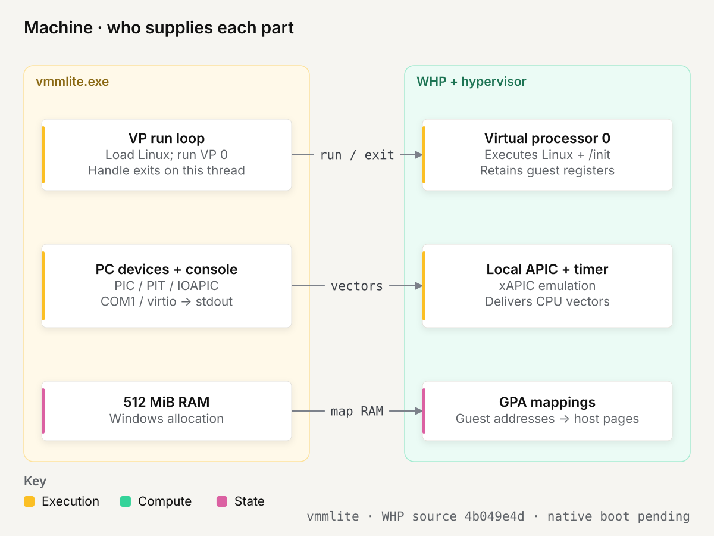
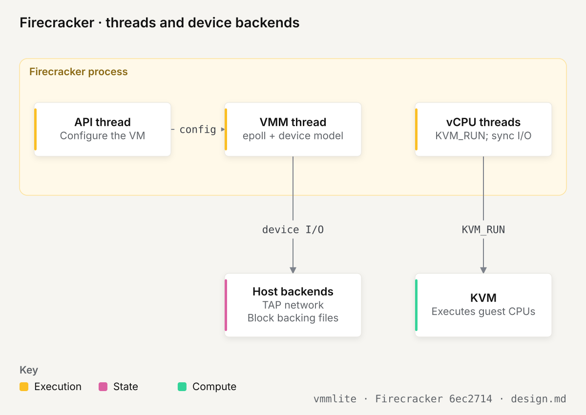
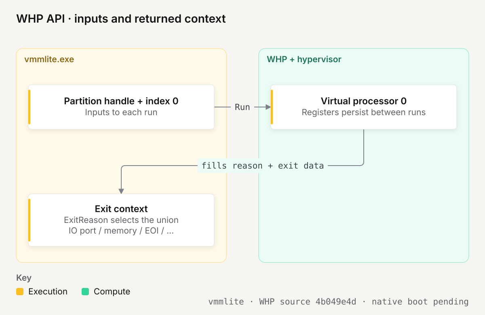
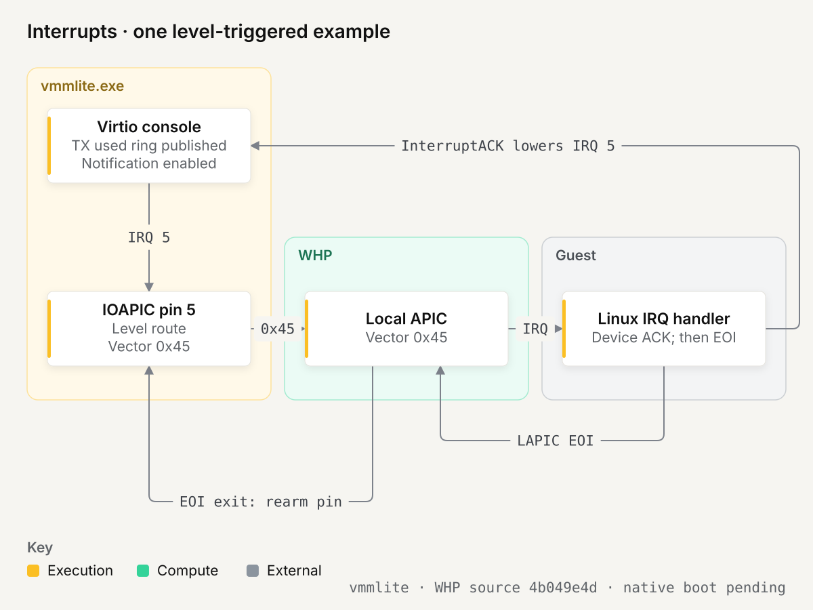

## TL;DR

Follow the original vmmlite's eight boot steps on Windows x64, using WHP for the CPU and a single C file for the machine.

## Details

This is the Windows companion to the [Linux/KVM example](../linux-x86_64/README.md).
The guest still runs the same [init.c](../init.c): PID 1 writes one line and reboots.
The source and the sections below use the original's organization and vocabulary.

**Native WHP boot is unverified.** Cross-compilation and portable tests are recorded
in section 3. Every guest sequence here is a source walkthrough, not a captured
Windows boot trace. This code is for learning, not a sandbox for untrusted programs.

### The machine at a glance

Follow PID 1's `write()` through the machine. Linux's tty and virtio driver put
output buffers in guest RAM and notify queue 1 at `0xd0000050`. vmmlite reads those
buffers and prints them in the Windows terminal. The tty may split the write or
translate its newline; the queue path is the same for each resulting buffer.

<picture>
  <source media="(prefers-color-scheme: dark)" srcset="images/machine/figure-blueprint.svg">
  
</picture>

| Part | What it does here | Who provides it |
| --- | --- | --- |
| Virtual CPU | Executes Linux instructions and retains its registers | WHP and hardware virtualization |
| Guest RAM | Holds Linux code, page tables, initramfs and console buffers | vmmlite allocation mapped through WHP |
| Local APIC | Queues CPU interrupt vectors and supplies the per-CPU timer | WHP local APIC emulation |
| IOAPIC | Converts device IRQ lines into vectors for the CPU | the PC helpers in `vmmlite.c` |
| PIC pair | Handles the older ISA interrupt path during initialization | the PC helpers in `vmmlite.c` |
| PIT | Supplies a legacy boot tick and channel-2 calibration countdown | the PC helpers in `vmmlite.c` |
| COM1 | Prints early kernel bytes | the PC helpers in `vmmlite.c` |
| Virtio console | Prints buffers from Linux's `hvc0` driver | `console_transmit()` |
| MP table | Tells Linux which CPU and IOAPIC exist and how IRQs are wired | `setup_mptable()` in §5 |
| Reset port | Turns the guest's reboot request into process termination | `pc_port()` and §8 |

The significant difference from KVM is the middle of this table. The Linux
example asks KVM to create a complete interrupt-controller set and PIT. WHP's
optional local APIC handles only the CPU-side controller. vmmlite supplies the
PIC, IOAPIC and PIT itself. See Microsoft's [partition properties](https://learn.microsoft.com/en-us/virtualization/api/hypervisor-platform/funcs/whvpartitionpropertydatatypes).

#### Firecracker's machine, for comparison

Both programs load a Linux kernel, provide guest RAM and respond to virtual-device
accesses. Firecracker adds a broader machine and host isolation mechanisms. Its
thread split also differs from this sample's synchronous virtio console.

<picture>
  <source media="(prefers-color-scheme: dark)" srcset="images/firecracker/figure-blueprint.svg">
  
</picture>

| Responsibility | vmmlite on WHP | Firecracker on Linux |
| --- | --- | --- |
| Guest CPU | One VP through WHP | One KVM_RUN thread per vCPU |
| Device work | VP thread handles exits; TX completes synchronously | VMM epoll loop handles devices; vCPU threads handle synchronous I/O |
| Host control | Command-line kernel and initramfs | Separate API thread forwards configuration requests |
| Guest I/O | COM1 and transmit-only virtio console | Network, block and vsock, among other devices |
| Device backing | stdout and guest RAM | TAP interfaces, host files and other device backends |
| Host isolation | No process confinement in this teaching sample | Per-thread seccomp; jailer configures process isolation |

The comparison follows [Firecracker's design at 6ec2714](https://github.com/firecracker-microvm/firecracker/blob/6ec271414300fb8f0ff1ff79ad321bb7467d072f/docs/design.md#threads).
It describes responsibilities, not a performance comparison. Firecracker's security
mechanisms are outside this example's scope.

### 0. Background: the CPU, WHP and devices

Nine short topics: 0.1–0.5 cover the CPU and WHP, 0.6–0.9 cover devices.
Each ends with where vmmlite uses it. The § signs refer to the eight banners in
`main()`, exactly as in the original article.

#### 0.1 x86 system architecture: what the kernel controls

`vmmlite.exe` is a Windows process. `/init` is a Linux process inside the guest;
the kernel between `/init` and the virtual hardware is a real x86_64 Linux kernel.

| CPU state | What it controls | Initial value here |
| --- | --- | --- |
| `RIP`, general registers | Which instruction runs and its operands | `RIP = 0x100200`, `RSI = 0x7000` |
| `CS`, data segments, GDT | Code/data attributes and privilege | 64-bit ring-0 code, flat data |
| `CR0`, `CR4`, `EFER` | Protected mode, paging, long mode | Long mode already enabled |
| `CR3` | Root of the guest's page tables | PML4 at `0x9000` |
| IDT and interrupt state | Where events go and whether delivery is allowed | Linux installs its own handlers; maskable interrupts start disabled |
| Local APIC | Interrupt priority, delivery and the per-CPU timer | WHP's xAPIC emulation |

The guest's ring 0 is its own privilege domain. Hardware virtualization separates
it from the Windows kernel. A guest may change its `CR3` without changing the host's
page-table root. The hypervisor retains a separate register context for VP 0.

**In vmmlite:** §6 writes the temporary GDT and page tables; §7 installs the matching register state in one batch. Linux replaces those temporary structures as it boots.

#### 0.2 Guest mode: VM entry and VM exit

The real CPU executes the guest's instructions. Hardware virtualization can stop
them when an operation needs the hypervisor's attention: a **VM exit**.
That does not always return control to `vmmlite.exe`; the hypervisor can handle an
operation and resume the guest itself.

```text
vmmlite                          WHP / hypervisor                    CPU
WHvRunVirtualProcessor() ------> enter VP 0 -----------------------> guest instructions
                                 handle internal exits <---------- VM exit
exit context <----------------- an exit the application must handle
emulate, then run again -------> re-enter VP 0 --------------------> next guest instruction
```

The application keeps the same partition handle and VP index across calls. The
exit context is a description of why the call returned, not a replacement for the
CPU's saved state. [Run API](https://learn.microsoft.com/en-us/virtualization/api/hypervisor-platform/funcs/whvrunvirtualprocessor)

**In vmmlite:** §8 runs VP 0 repeatedly. IO/MMIO completion changes its registers through the emulator callbacks, then the next run resumes it.

#### 0.3 Guest memory: translated twice

Suppose Linux writes text at guest virtual address `V`. Its page tables translate
`V` into guest physical address `G`. WHP's memory mapping connects `G` to the
host allocation. For this sample, host code accesses those bytes as `ram.bytes + G`.

```text
Linux instruction
       |
       v
guest virtual address V
       | guest page tables, selected by the guest's CR3
       v
guest physical address G
       | WHP GPA mapping, implemented through hardware virtualization
       v
the host pages backing ram.bytes + G
```

Calling `WHvMapGpaRange` does not create the guest's page tables. Conversely,
writing a PML4 into guest RAM does not give the guest access to host memory.
[WHvMapGpaRange](https://learn.microsoft.com/en-us/virtualization/api/hypervisor-platform/funcs/whvmapgparange)

The loader initially identity-maps the first GiB: `V = G`. It backs only the
first 512 MiB with RAM. Later, Linux installs its own mappings, including mappings
for device registers outside RAM.

**In vmmlite:** §2 maps 512 MiB through `WHvMapGpaRange`; §6 independently writes the guest page tables. GPA X is `vm.ram.bytes + X` in the host.

#### 0.4 What exits, and who handles it

The configured machine has two layers of handlers:

| Operation | Who handles it | What vmmlite sees |
| --- | --- | --- |
| Ordinary instructions and mapped RAM | CPU and hypervisor | No device callback |
| Local APIC registers/timer | WHP's local APIC emulation | EOI exits needed to rearm level IOAPIC routes |
| PIC/PIT/COM1 port access | vmmlite, through WinHvEmulation | IO-port exit |
| Virtio or IOAPIC register access | vmmlite, through WinHvEmulation | Memory-access exit |
| Selected CPUID leaves | vmmlite's `cpuid()` | WHP's default results plus the guest inputs |
| Timer-helper cancellation | vmmlite's next loop iteration | Canceled exit |
| Interrupt-window notification | vmmlite's PIC delivery helper | A chance to retry the pending external interrupt |

An unexpected exit prints its reason and guest `RIP`, then ends the run with an
error. The loop also handles a legacy HLT exit by yielding briefly; current WHP
normally manages HLT internally. [QEMU's WHPX exit handling](https://github.com/qemu/qemu/blob/v9.2.0/target/i386/whpx/whpx-all.c)

The CPUID handler begins with WHP's partition defaults. It clears the
hypervisor-identification bit and intercepted vendor leaves because this sample
has no Hyper-V guest ABI. It does not advertise KVM's paravirtual clock.
[CPUID defaults](https://learn.microsoft.com/en-us/virtualization/api/hypervisor-platform/funcs/cpuidaccess)

**In vmmlite:** §1 selects CPUID exits and xAPIC emulation; §8 dispatches `exit.ExitReason`. `cpuid()` advances RIP itself; the instruction emulator advances it for IO/MMIO.

#### 0.5 WHP's API: a partition handle, VP index and exit context

<picture>
  <source media="(prefers-color-scheme: dark)" srcset="images/api/figure-blueprint.svg">
  
</picture>

The API has three objects to keep separate: the partition handle, processor index `0`, and a caller-owned exit report. The host's RAM allocation and instruction-emulator handle are separate resources.

| Object | Created by | How the code uses it |
| --- | --- | --- |
| `vm.partition` | `WHvCreatePartition` in §1 | Names the machine for mappings, VP operations and interrupt requests |
| VP index `0` | `WHvCreateVirtualProcessor` in §7 | Selects the one CPU inside that partition; it is not a second handle |
| `exit` | A local variable on each §8 iteration | Receives the exit reason, instruction context and reason-specific fields |
| `vm.emulator` | `WHvEmulatorCreateEmulator` in §8 | Decodes IO/MMIO instructions using callbacks into this process |

The setup order keeps configuration separate from execution:

```text
create partition -> set processor count, xAPIC and exit properties -> setup partition
                 -> map guest RAM -> create VP 0 -> set entry registers -> run VP 0
```

`WHvRunVirtualProcessor(partition, 0, &exit, sizeof exit)` updates the supplied report. Its reason selects the meaningful part of the union:

```text
exit.ExitReason       -> choose the handler
exit.VpContext        -> current RIP and instruction context
exit.IoPortAccess     -> intercepted IN/OUT
exit.MemoryAccess     -> intercepted memory access
exit.CpuidAccess      -> guest inputs and WHP's default CPUID results
exit.ApicEoi          -> vector whose service the guest ended
```

The VP's registers remain in WHP. `get_registers()` and `set_registers()` read or update that state; the report is not KVM's shared `kvm_run` page. [Run API](https://learn.microsoft.com/en-us/virtualization/api/hypervisor-platform/funcs/whvrunvirtualprocessor)

**In vmmlite:** `struct vm` owns the host resources. §1 creates the partition, §7 creates VP 0, and §8 repeatedly supplies an exit report. Cleanup joins the timer helper before deleting resources it can still reach.

#### 0.6 Device registers: I/O ports and MMIO

x86 has two ways to address a device. **Port IO** uses `IN`/`OUT` and a 16-bit
port number. **MMIO** uses ordinary loads/stores to a memory address occupied by
device registers. A register is an interface to behavior; reading it can acknowledge
an event, and writing it can start work.

| Address | Interface | Handler |
| --- | --- | --- |
| Ports `0x20/0x21`, `0xa0/0xa1` | Master/slave PIC command and data | `pic_port()` |
| Ports `0x40–0x43`, `0x61` | PIT channels, control, channel-2 gate/output | `pit_port()`, `pit_control()`, `pc_port()` |
| Ports `0x3f8–0x3ff` | COM1 | `com1()` |
| Port `0x64`, value `0xfe` | i8042 reset | `pc_port()` |
| GPA `0xd0000000`, 4 KiB | Virtio console | `console_register_read/write()` |
| GPA `0xfec00000` | IOAPIC selector/window | `pc_mmio()` |
| GPA `0xfee00000` | Local APIC | WHP |

Two concrete accesses show the difference between a register value and a queued payload. These are source walkthroughs.

```text
UART write, with LCR.DLAB clear:
  Linux: OUT 0x3f8, 'H'
    -> WHP IO-port exit -> WHvEmulatorTryIoEmulation()
    -> io(): port=0x3f8, size=1, write=true
    -> pc_port() -> com1(UART_TX) -> stdout receives 'H'

Virtio feature read, after DEVICE_FEATURES_SEL=1:
  Linux: 32-bit load at GPA 0xd0000010
    -> WHP memory-access exit -> WHvEmulatorTryMmioEmulation()
    -> memory() -> console_register_read(DEVICE_FEATURES) -> value 1
    -> emulator updates the destination register and RIP
    -> Linux sees bit 32, VIRTIO_F_VERSION_1
```

A write of `1` to `QUEUE_NOTIFY` at `0xd0000050` uses that same MMIO path. The value selects queue 1. `console_transmit()` finds the text through descriptors in guest RAM (0.9).

The UART names match the Linux and macOS sources. `UART_LSR_TEMT | UART_LSR_THRE = 0x60` says both transmit stages are empty. Setting `UART_LCR_DLAB` redirects registers 0 and 1 to the baud divisor: those writes must not print characters. `UART_IER_THRI` enables the TX-empty interrupt; reading `UART_IIR` acknowledges it.

`WinHvEmulation` decodes the x86 instruction. The application supplies the pieces it cannot own:

| Callback | Responsibility |
| --- | --- |
| `get_registers()`, `set_registers()` | Read operands and commit the completed instruction's CPU state |
| `translate()` | Translate a guest virtual page to a guest physical page |
| `memory()` | Read/write ordinary RAM or dispatch a console/IOAPIC register access |
| `io()` | Advance the PIT clock and dispatch a port access through `pc_port()` |

One instruction may cause several callbacks, for example with a REP prefix. The memory callback also serves RAM when the emulator fetches instruction or operand bytes. Unknown MMIO fails with a diagnostic; absent ISA/PCI port reads return all ones.

The host checks both HRESULT and `EmulationSuccessful`. The emulator completes IO/MMIO and updates RIP; `cpuid()` advances RIP itself. Incrementing it again after successful emulation would skip an instruction. [Instruction-emulation contract](https://learn.microsoft.com/en-us/virtualization/api/hypervisor-instruction-emulator/funcs/whvemulatortryemulation), [callback structure](https://learn.microsoft.com/en-us/virtualization/api/hypervisor-instruction-emulator/funcs/whvemulatorcallbacks)

**In vmmlite:** §8 connects these callbacks to WinHvEmulation. Register tables sit beside the device handlers; the guest's queue data stays in shared RAM.

#### 0.7 How the guest learns its hardware: MP table, ACPI and the command line

There is no BIOS, UEFI image, ACPI table set or PCI device enumeration for this
console. The loader supplies an MP table and a kernel command line:

```text
earlycon=uart8250,io,0x3f8 console=hvc0 panic=-1 reboot=k virtio_mmio.device=4K@0xd0000000:5
```

The command line identifies COM1 and the virtio device. The MP table identifies
one processor, one IOAPIC, an ISA bus, and the mapping from each ISA IRQ to an
IOAPIC pin. These are descriptions, not executable firmware.

The zero page, MP table and command line have different readers:

| Data | Producer | Consumer / meaning |
| --- | --- | --- |
| Zero page at `0x7000` | `setup_zero_page()`, §4 | RSI tells the kernel where to find boot parameters |
| E820 entries inside it | `setup_zero_page()`, §4 | Linux learns which backed bytes it may allocate |
| `_MP_` → `PCMP` at `0x9fc00` | `setup_mptable()`, §5 | Linux discovers CPU 0, IOAPIC 1 and ISA routes |
| Command line at `0x20000` | `setup_zero_page()`, §4 | The serial and virtio drivers learn console addresses |

```text
Linux scans for _MP_ -> follows PCMP -> finds ISA IRQ 5 -> IOAPIC pin 5
Linux parses virtio_mmio.device -> probes 0xd0000000 -> binds console -> requests IRQ 5
                               -> programs the IOAPIC route -> later consumes used buffers
```

The tables describe hardware; the helpers implement it. The macOS companion passes
a device tree in `x0` for this role. Here, `RSI` points to boot parameters and Linux
separately scans for the MP table. Neither example executes firmware.

Three places must agree about the console:

| Place | Value |
| --- | --- |
| Kernel command line | Device registers at `0xd0000000`, IRQ 5 |
| MP table | ISA IRQ 5 routes to IOAPIC pin 5 |
| Console completion | `pc_irq(..., VIRTIO_CONSOLE_IRQ, true)`, where `VIRTIO_CONSOLE_IRQ = 5` |

This source uses IRQ n → pin n, including PIT IRQ 0 → pin 0. QEMU's conventional
PC path instead remaps the PIT to pin 2. A wire number only makes sense together
with the machine description. [QEMU IOAPIC routing](https://github.com/qemu/qemu/blob/v9.2.0/hw/intc/ioapic.c#L160-L195)

**In vmmlite:** §4 writes the command line and E820 map. §5 writes the MP table and its checksums. There are no ACPI tables or executable firmware in this example.

#### 0.8 Interrupts: from a device's line to a CPU

IRQ 5 is a device line number. It is not necessarily CPU vector 5. Linux programs
the IOAPIC redirection entry with the vector it chose and the destination CPU.
vmmlite reads that entry when the line changes, then calls `WHvRequestInterrupt`.
WHP's local APIC handles delivery to the virtual CPU. [Interrupt API](https://learn.microsoft.com/en-us/virtualization/api/hypervisor-platform/funcs/whvrequestinterrupt)

When TX notifications are enabled, an illustrative level-triggered entry using
vector `0x45` follows this path. This is a source walkthrough, not a captured IRQ
trace; Linux chooses the actual vector and trigger mode.

<picture>
  <source media="(prefers-color-scheme: dark)" srcset="images/interrupts/figure-blueprint.svg">
  
</picture>

```text
console finishes TX
  -> set InterruptStatus bit 0
  -> raise IRQ 5
  -> IOAPIC pin 5 requests vector 0x45; mark remote IRR
  -> WHP local APIC delivers vector 0x45
  -> Linux handler writes InterruptACK; console lowers IRQ 5
  -> Linux writes local APIC EOI
  -> WHP APIC-EOI exit; pc_eoi clears remote IRR
```

If the line is still asserted at EOI, `pc_eoi` requests delivery again. If it has
been lowered, it stops. The remote-IRR bit prevents repeatedly delivering a level
while the previous interrupt is still in service. Edge-triggered entries use
rising edges instead. [QEMU's level/EOI behavior](https://github.com/qemu/qemu/blob/v9.2.0/hw/intc/ioapic.c#L223-L310)

The PIC path is different. `pic_interrupt` waits until the guest enables
interrupts, leaves its interrupt shadow, and has no conflicting pending event.
It then installs a pending external interrupt with the PIC's vector. If the
guest is not ready, it requests an interrupt-window notification. The code also
clears the VP's halt suspension when injecting this external interrupt.

**The early timer.**

WHP's local APIC timer does not remove the earlier work Linux does to establish
time. The code models PIT channel 0 for the legacy tick and channel 2 for
calibration. Linux can program channel 2, then poll bit 5 of port `0x61` until
the countdown completes.

`pc_tick` derives PIT ticks from a monotonic host time at 1,193,182 ticks per
second. Count reads and latched reads use that same clock. They do not change
according to how many times the guest reads the port.

A Windows timer wakes a helper every millisecond. The helper calls
`WHvCancelRunVirtualProcessor`, causing the main thread to regain control and
service elapsed PIT deadlines. It never touches guest RAM or emulated-device
state. Missed periods are coalesced into one interrupt request; this is a small
teaching timer, not a precise virtual-time or migration model.

```text
timer helper: host timer expires -> WHvCancelRunVirtualProcessor -> waits again
VP thread:    WHP run returns    -> pc_tick(now_ns) -> interrupt delivery -> run again
```

Linux's [local APIC calibration](https://github.com/torvalds/linux/blob/v6.12/arch/x86/kernel/apic/apic.c#L830-L950)
can wait for a global tick or a known TSC interval and can check the result against
a global clockevent. This is why a native boot test must exercise timing, even
after unit tests establish the PIT register behavior.

**In vmmlite:** `pc_irq()` records device lines, `ioapic_deliver()` requests a LAPIC vector, and `pc_eoi()` handles completion. §8 services `pc_tick()` and `pic_interrupt()` before running the guest.

#### 0.9 Virtqueues: setup, then data through shared memory

A split virtqueue has three areas in guest RAM. Registers configure those areas; a notification says there is work to consume. The text itself never travels in the notification.

The setup below follows this implementation. It is not a captured Windows trace or a fixed count of Linux register accesses.

| Phase | Guest action | vmmlite's response |
| --- | --- | --- |
| Identify | Read magic, version and device ID | Return `"virt"`, modern MMIO version 2 and console ID 3 |
| Reset | Write `STATUS = 0` | Clear queues, features and pending interrupt; lower IRQ 5 |
| Claim | Write status 1, then 3 | Record ACKNOWLEDGE and DRIVER |
| Negotiate | Select feature page 1; accept its bit 0 | Offer only overall bit 32, `VIRTIO_F_VERSION_1` |
| Accept features | Set FEATURES_OK, status `0xb`, then read it back | Keep FEATURES_OK only if accepted features equal the offered set |
| Configure queues | Select queue 0 or 1; write size and descriptor/available/used GPAs | Retain both queue descriptions |
| Enable queue | Write `QUEUE_READY = 1` | Check accepted features, power-of-two size, alignment and RAM bounds |
| Start | Set DRIVER_OK, status `0xf` | Permit TX when queue 1 is also ready |
| Notify | Write queue number to `QUEUE_NOTIFY` | Queue 1 drains TX; queue 0 leaves receive buffers untouched |

Both queue descriptions are retained on WHP; the macOS and Linux teaching examples retain only transmit state. None supplies an input source. No packed rings, indirect descriptors, multiport control queues or event-index feature is offered.

| Area | Writer | Layout for a queue of `size` entries |
| --- | --- | --- |
| Descriptor table | Guest | `16 * size` bytes, aligned to 16; each entry is `{address, length, flags, next}` |
| Available ring | Guest | `6 + 2 * size` bytes, aligned to 2; flags, index, head array and unused event field |
| Used ring | Device | `6 + 8 * size` bytes, aligned to 4; flags, index, `{id, len}` array and unused event field |

The bounds checks reserve the trailing event fields, but EVENT_IDX is not negotiated. The 16-bit indices count entries and wrap at 65536; a slot is `index % size`. Queue size is a power of two up to 256.

A concrete example comes from `virtio()` in [the portable production-code tests](tests/machine_test.c). It uses a size-8 queue, with descriptor/available/used areas at `0x1000/0x2000/0x3000`:

```text
guest RAM before the kick                     device result
desc[0] = {0x7000, 6, NEXT, 1}                 output: "Hello WHP!\n" (11 bytes)
desc[1] = {0x7100, 5, 0,    0}                 used.ring[0] = {id: 0, len: 0}
RAM[0x7000] = "Hello "                        used.idx = 1
RAM[0x7100] = "WHP!\n"                        next_avail = next_used = 1
avail.ring[0] = 0; avail.idx = 1               InterruptStatus = 1
                  QUEUE_NOTIFY = 1 -------->  IRQ 5 -> configured vector 0x45
```

Those addresses and vector belong to the test fixture, not a native Linux boot. The test calls the production register handler, records output bytes and interrupt requests, and inspects the used ring.

The completion path has five steps:

1. Validate the entire descriptor chain before printing any of its buffers.
2. Read each buffer from guest RAM and send its bytes to the output callback.
3. Write `{head, 0}` to the used ring. Length is zero because TX reads guest buffers; it writes no bytes into them.
4. Advance `next_avail`, `next_used` and the published used index.
5. After draining new chains, set interrupt status and raise IRQ 5 unless the available-ring flags suppress notification.

A malformed chain produces no output or used entry for that chain. Previously completed chains remain completed. Out-of-range indices, writable/indirect TX descriptors, cycles and buffers outside RAM stop the operation.

A guest can reclaim buffers by reading the used ring before handling an interrupt. `INTERRUPT_ACK` lowers the device line; LAPIC EOI separately ends interrupt service (0.8). PID 1 writes 18 application bytes, but the tty can split a write or translate its newline; one write does not guarantee one descriptor or interrupt.

| Boundary | Linux/KVM example | macOS example | WHP example |
| --- | --- | --- | --- |
| Queue-1 kick | KVM ioeventfd wakes `console_thread()` | MMIO exit calls `console_kick()` | MMIO exit calls `console_transmit()` |
| Data access | Console worker reads guest RAM | Stopped-vCPU handler reads guest RAM | Stopped-VP handler reads guest RAM |
| Completion | Used ring, then irqfd | Used ring, then framework GIC | Used ring, then software IOAPIC and WHP LAPIC |

**In vmmlite:** the control path is `console_register_read/write()`; the data path is `console_transmit()`. VP 0 stays stopped throughout the callback, and the timer helper never touches rings. Adding a second VP or device worker would require synchronization. [Virtio split rings, MMIO and console](https://docs.oasis-open.org/virtio/virtio/v1.2/virtio-v1.2.html)

### 1. How vmmlite boots Linux

The eight banners in `main()` prepare and run the machine. Guest actions happen
inside §8; they are not additional setup sections. This is a source walkthrough.

```text
host setup
  §1 partition + xAPIC + PC devices
  §2 mapped RAM + console
  §3 bzImage payload
  §4 zero page + command line + initramfs + E820
  §5 MP table
  §6 GDT + page tables
  §7 VP 0 + long-mode registers
  §8 run loop ------------------------------------------> Linux decompressor
       com1() <---------------------- port IO ------------ early kernel output
       console_register_*() <-------- MMIO -------------- hvc0 driver setup
       console_transmit() <---------- QUEUE_NOTIFY=1 ----- output buffers
       used ring + optional IRQ 5 ----------------------> reclaim buffers
       pc_port(): reset=true <------- OUT 0x64=0xfe ------ reboot
       stop helper -> release VM -> return 0
```

| § | Step | WHP calls / source |
| --- | --- | --- |
| 1 | A partition, with one processor and a local APIC; create the PIC, IOAPIC and PIT state | `WHvCreatePartition`, `WHvSetPartitionProperty`, `WHvSetupPartition`, `pc_create` |
| 2 | 512 MiB of host memory as guest RAM at address 0; create the console state | `VirtualAlloc`, `WHvMapGpaRange`, `console_create` |
| 3 | Validate the bzImage and initramfs placement, then copy the kernel payload to 1 MiB | `load_kernel` |
| 4 | The zero page: setup header, command line, initramfs and E820 map | `setup_zero_page` |
| 5 | An MP table: one CPU, one IOAPIC, ISA IRQ n → pin n | `setup_mptable` |
| 6 | A GDT and identity-mapped page tables for long mode | `setup_page_tables` |
| 7 | One vCPU in long mode at the 64-bit entry, RSI at the zero page | `WHvCreateVirtualProcessor`, `boot_registers` → `WHvSetVirtualProcessorRegisters` |
| 8 | The run loop: port IO, device MMIO, CPUID, interrupt delivery, and guest reset | `WHvRunVirtualProcessor`, WinHvEmulation callbacks, `WHvRequestInterrupt` |

#### 1.1 Where everything lands: the guest memory map

All addresses below are **guest physical addresses**. High addresses are at the top.

```text
0xfee00000    WHP local APIC registers
0xfec00000    vmmlite IOAPIC registers
0xd0000000    vmmlite virtio console registers (4 KiB)
              ... no RAM backing for these device addresses ...
0x20000000  +---------------------------------------+  end of 512 MiB RAM
            | initramfs, aligned down to 4 KiB       |
            +---------------------------------------+
            | free RAM and kernel runtime window    |
            | runtime start honors preferred        |
            | address and kernel alignment          |
            +---------------------------------------+
0x00100200  | compressed kernel's 64-bit entry       |
0x00100000  | copied protected-mode payload          |
            +---------------------------------------+
0x0009fc00  | MP table; excluded from usable E820 RAM |
0x00020000  | command line                           |
0x0000b000  | page directory: 512 x 2 MiB mappings    |
0x0000a000  | page-directory-pointer table           |
0x00009000  | PML4                                   |
0x00007000  | zero page: Linux boot parameters       |
0x00000500  | GDT                                    |
0x00000413  | BIOS data: conventional memory size    |
0x00000000  +---------------------------------------+
```

`load_kernel()` checks the setup header before copying. It locates the protected-mode
payload after the boot sector and setup sectors. The initramfs sits below both
the RAM ceiling and the kernel's allowed initrd ceiling. Its start must also be
above the kernel's initialization window, including any relocation to a preferred
and aligned runtime address.

The zero page copies the kernel's setup header and then sets the loader-owned
fields: loader ID, command-line pointer, initramfs address and size, ordinary-PC
subarchitecture, and E820 RAM entries. [Linux boot protocol](https://docs.kernel.org/arch/x86/boot.html)

`setup_page_tables()` in §6 writes the GDT and initial page tables. `boot_registers()` in §7 installs their
addresses in the VP and enters long mode directly:

| Register/state | Value in this implementation |
| --- | --- |
| `RIP` | `0x100200`, the compressed kernel's 64-bit entry |
| `RSI` | `0x7000`, the zero-page address |
| `RFLAGS` | `2`, with maskable interrupts initially disabled |
| `CR3` | `0x9000`, the PML4 address |
| `CR0` | `0x80000031`, including protected mode and paging |
| `CR4` | `0x20`, physical-address extension |
| `EFER` | `0x500`, long-mode enable and active state |
| `CS`, data segments | Selectors `0x10` and `0x18` with matching cached descriptors |
| `GDTR` | Base `0x500`, limit 31 |
| APIC base | `0xfee00000`, enabled, bootstrap processor |

The decompressor and Linux then replace the temporary boot structures with
their own. The host does not interpret ELF sections or run the 16-bit setup code.

Try it: predict the effect before running on a WHP host.

- Set `RAM_SIZE` to 256 MiB: the E820 range and initramfs ceiling move down;
  the low boot tables and device addresses stay put. The loader rejects a kernel
  whose full initialization window no longer fits.
- Remove the initramfs address from the zero page: Linux cannot find this `/init`.
  A resulting panic may reboot because of `panic=-1`; the harness still rejects
  the run because the PID 1 message is missing.

### 2. The code

The numbered banners in [vmmlite.c](vmmlite.c) are the §1–§8 used throughout this article. Start at `main()` for the boot sequence, then follow each helper when you reach it. Everything remains in one C file.

#### 2.1 vmmlite.c

The file follows the same reading pattern as the Linux and macOS examples: named addresses, small utilities, device models, boot preparation and the numbered entry point.

| Source group | Question it answers |
| --- | --- |
| Guest bytes and host files | How does a guest address become a bounded host-memory access? |
| PIC and IOAPIC | Which pending line can reach the CPU, and when can it be delivered again? |
| PIT and COM1 | How do early timing and serial output work before virtio is ready? |
| Port dispatch | Which device owns an IN/OUT, including the reset command? |
| Virtio console | How do register setup and shared-memory completion fit together? |
| Boot data and initial CPU state | What goes in guest RAM, and what goes in WHP's register state? |
| WHP runtime callbacks | Who completes instructions, injects interrupts and wakes the run loop? |
| `main()`, §1–§8 | In which order are the machine and its resources assembled? |

The `VMMLITE_TEST` guards leave out Windows host APIs and `main()`. [tests/machine_test.c](tests/machine_test.c) includes the production source and exercises its actual loader and device helpers, including the §3–§6 preparation sequence.

Ownership is deliberately narrow:

```text
VP thread:    guest RAM, device state, output and all queue completion
timer helper: wait for a host timer -> cancel WHP run -> VP thread services PIT
shutdown:     signal helper -> join -> destroy emulator/devices/VP -> unmap/free RAM
```

The helper must finish before the partition or VP is deleted. This order also applies when setup stops partway through.

#### 2.2 init.c (the guest's PID 1)

[init.c](../init.c) stays shared at the repository root. Its `write()` travels
through the guest's tty and `hvc0` driver to queue 1. `tcdrain()` waits for output
completion, then `reboot()` requests restart. `reboot=k` in §4 selects the i8042
reset command that `pc_port()` recognizes.

### 3. Build, run and verification

Start with the [build prerequisites and kernel requirements](README.md#run-it):
Zig, GNU Make and a native C compiler for the portable checks; `cpio` for the guest
archive. The Linux kernel must be an x86_64 bzImage with built-in virtio-console support.

```sh
# On the build machine, from windows-x86_64/:
make check
make guest
make check-image KERNEL=/path/to/bzImage
```

Copy `vmmlite.exe`, the supported `bzImage`, `initramfs.cpio` and `test-boot.ps1`
to a WHP-enabled Windows 11 x64 host. From that directory:

```powershell
.\vmmlite.exe --probe
.\test-boot.ps1 -Kernel .\bzImage -Initramfs .\initramfs.cpio
```

The [Makefile](Makefile) builds the host and guest separately. The [native harness](test-boot.ps1)
requires the PID 1 greeting, nonzero virtio TX, guest reset and exit 0 within its timeout.
It retains stdout, stderr, Windows version and artifact hashes.

**Native Windows/WHP boot remains pending.** These observations have different scopes:

| Environment | Observed work | What it establishes |
| --- | --- | --- |
| macOS ARM64, Zig 0.16.0 | Windows x64 PE cross-build | The single source compiles and links against WHP/WinHvEmulation |
| macOS ARM64, ASan/UBSan | Portable production-code tests | Loader layout and malformed-input checks; PIC/IOAPIC, PIT/UART and virtio contracts |
| macOS ARM64, Ubuntu `6.8.0-147-generic` bzImage | Load image and initramfs into RAM | Header acceptance and placement; no guest instructions run |
| Native Windows x64 | **Pending** | Initial CPU-state acceptance, interrupt/timer delivery and Linux boot remain unverified |

The host-side real-image loading result was recorded before this readability revision;
it is not a new Windows boot result. The portable check is rerun for code revisions.

Expected final guest message, not yet captured on WHP:

```text
Hello from PID 1!
```

A reboot alone is insufficient: a panic can also reset the guest. The portable
tests exercise production loader/device helpers and malformed inputs; cross-building
checks Windows headers and linking. Native register acceptance, timer/interrupt
delivery and Linux boot still require the Windows harness.

### 4. Why it looks like this

| Choice | Why | WHP consequence |
| --- | --- | --- |
| One C file with eight boot steps | Keep code and walkthrough in the original's reading order | Extra PC-device helpers remain visible before `main()` |
| Long mode prepared by the VMM | Enter the bzImage at its 64-bit entry | Write GDT/page tables, then batch the initial WHP register state |
| Two consoles: COM1, then hvc0 | The virtio driver becomes available later in boot | `com1()` prints early bytes; `console_transmit()` prints queued buffers |
| MP table and command line | Describe one CPU, an IOAPIC and the console without executable firmware | IRQ n → pin n agrees with the device model |
| PIC, IOAPIC and PIT in userspace | WHP's local APIC is the CPU-side controller | vmmlite supplies the legacy timer and device interrupt routing |
| Synchronous virtio TX | The only VP is stopped during a callback | No console worker or concurrent guest access to the rings |
| WHP's instruction emulator | x86 IO/MMIO instructions need decoding and register updates | Supply RAM, register and translation callbacks; check both completion results |
| WHP's CPUID defaults, filtered identification | There is no Hyper-V guest ABI in this sample | Keep the supplied timer devices; validate timing on Windows |
| Bounded native boot harness | A panic can also reset the guest | Require PID 1 output, nonzero virtio TX, reset and exit 0 together |

Missing on purpose: disks, network, interactive input, more than one vCPU,
executable BIOS/UEFI, ACPI power management, snapshots, a migration clock and
host-process confinement.

The implemented devices also have limits: a fixed RTC date without RTC interrupts,
fixed-priority PIC, binary PIT modes 0/2/3, and IOAPIC fixed, lowest-priority and
NMI delivery only. Other PIT or IOAPIC modes produce a diagnostic. Queue 0's input
buffers remain untouched. These are teaching constraints, not a general PC model.

Before treating a kernel as supported, retain a native Windows boot result for
that kernel. The [design issue](https://github.com/boxlite-ai/vmmlite/issues/13)
tracks that remaining acceptance step.

### Sources

**Original structure and guest contract**

- [vmmlite.c at c4bd3f4](https://github.com/boxlite-ai/vmmlite/blob/c4bd3f4f3a9317ea6d97b78d83c7368f2a0a85f4/vmmlite.c): device comments, diagrams and eight boot sections
- [macOS source at b301f5f](https://github.com/boxlite-ai/vmmlite/blob/b301f5fbd808b1602b26ff5dcdf24d2281121ac6/macos/vmmlite.c): named UART registers, local flow comments and eight boot steps
- [Original README](https://github.com/boxlite-ai/vmmlite/blob/c4bd3f4f3a9317ea6d97b78d83c7368f2a0a85f4/README.md): Run it, How it works, Tested on, Learn more, License

**Comparison**

- [Firecracker design at 6ec2714](https://github.com/firecracker-microvm/firecracker/blob/6ec271414300fb8f0ff1ff79ad321bb7467d072f/docs/design.md): threads, device backends and host isolation

**WHP and instruction completion**

- [WHP API](https://learn.microsoft.com/en-us/virtualization/api/hypervisor-platform/hypervisor-platform): partition, mapping and virtual-processor lifecycle
- [Partition properties](https://learn.microsoft.com/en-us/virtualization/api/hypervisor-platform/funcs/whvpartitionpropertydatatypes): local APIC emulation and exit configuration
- [Instruction emulator](https://learn.microsoft.com/en-us/virtualization/api/hypervisor-instruction-emulator/funcs/whvemulatortryemulation): completion status, callbacks and register updates
- [Interrupt requests](https://learn.microsoft.com/en-us/virtualization/api/hypervisor-platform/funcs/whvrequestinterrupt): vector delivery to the local APIC

**Boot and devices**

- [Linux x86 boot protocol](https://docs.kernel.org/arch/x86/boot.html): 64-bit entry, boot parameters and initialization window
- [Linux v6.12 APIC calibration](https://github.com/torvalds/linux/blob/v6.12/arch/x86/kernel/apic/apic.c#L830-L950): boot-time clock dependencies
- [QEMU v9.2.0 IOAPIC](https://github.com/qemu/qemu/blob/v9.2.0/hw/intc/ioapic.c#L160-L310): edge, level, remote-IRR and EOI behavior
- [Virtio 1.2, §§2.6, 4.2 and 5.3](https://docs.oasis-open.org/virtio/virtio/v1.2/virtio-v1.2.html): split rings, MMIO transport and console queues
